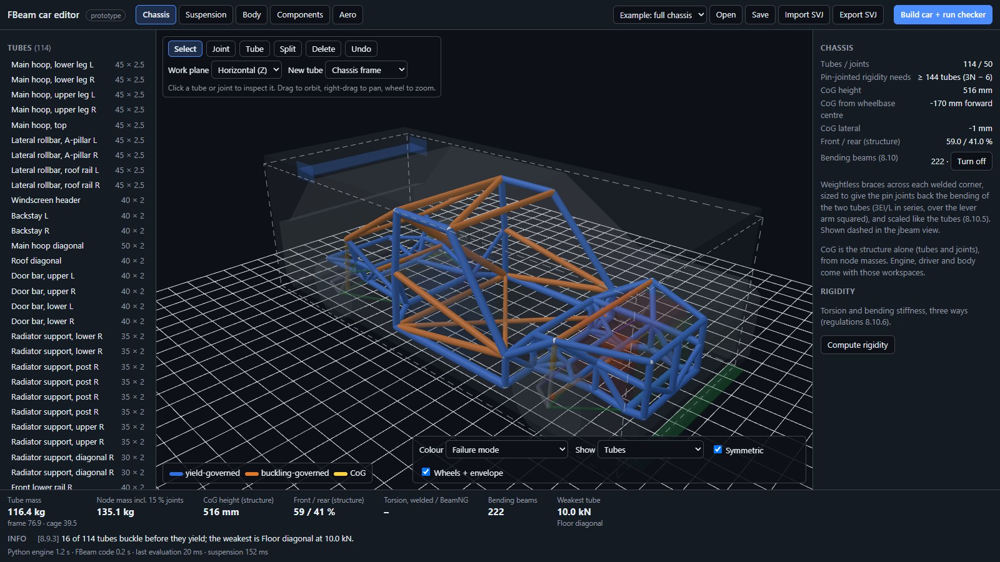
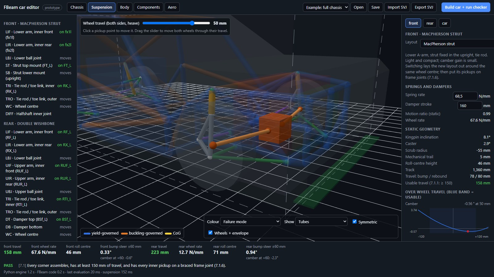
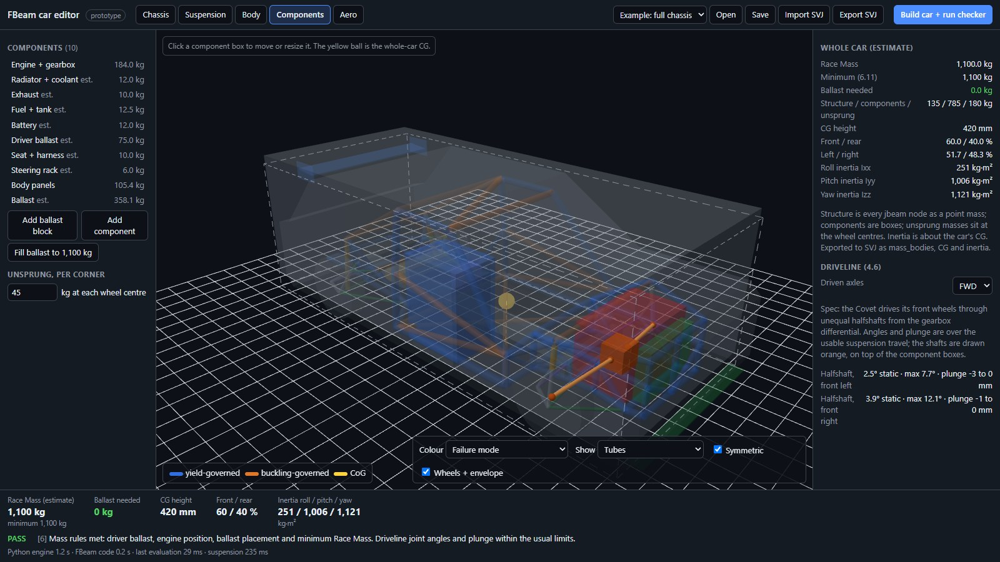
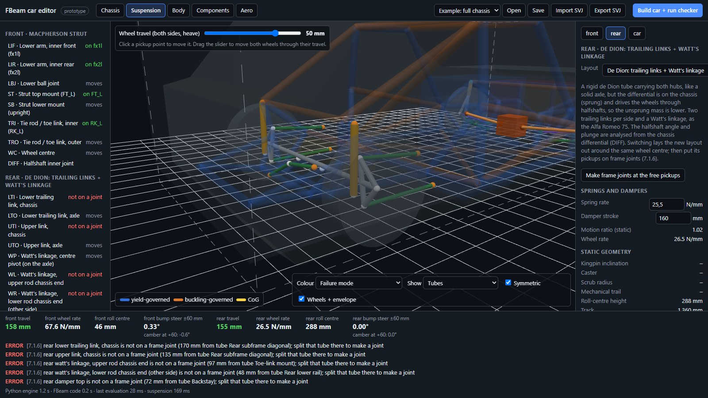
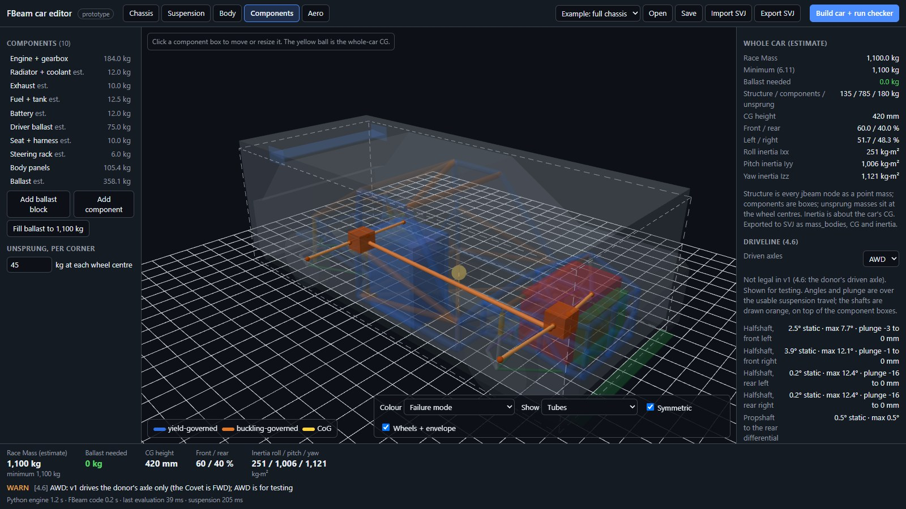

# FBeam

**An open engineering formula for BeamNG.drive rallycross, where a jbeam chassis has to be as honest as a real one.**

In BeamNG, a beam's stiffness, strength and mass are three independent numbers, so a car can be unbreakable and weigh nothing. FBeam closes that gap. Every structural beam declares the real steel or aluminium tube it represents. It may be no stiffer or stronger than that tube, and its nodes must carry that tube's weight. Strength costs mass, exactly as it does in a real car.

On top of that sits a spec series: compact rallycross cars the size of BeamNG's Ibishu Covet with one sealed engine, gearbox and tyre, taken from a vanilla BeamNG car. **FBeam is two competitions in one: engineers compete on building the best car, and drivers compete on driving it.**

## Two competitions in one

Real motorsport is won by a car and a driver together. FBeam keeps both halves, and the rules are shaped so each one matters.

| | Engineering side | Driving side |
| --- | --- | --- |
| Who | Teams of designers: people who like structures, vehicle dynamics and optimisation | Sim-racing drivers: people who like racecraft, car control and consistency |
| What they compete on | Chassis and cage design, weight and weight distribution, suspension geometry, springs and dampers, brake balance, setup for each track | Heats and finals on rallycross tracks: mixed gravel and tarmac, jumps, joker laps, contact |
| What is fixed | Engine, gearbox and tyres, so no team can buy lap time with power or grip | Every car has the same power and tyres, so gaps come from the car's engineering and the driving |
| What decides it | Engineering that is physically honest: strength paid for in mass, checked by the tools before the car may race | Lap time, racecraft, and keeping the car in one piece |
| Their tools | The rulebook, the checker, the cage calculator, and later the car editor | BeamNG and the team's car, with setup changes allowed between sessions |

The two sides depend on each other:
- **Drivers need honest cars.** Because the rules close BeamNG's physics shortcuts (unbreakable beams, weightless structures, scripted grip), a fast car is fast for real engineering reasons.
- **Engineers need honest driving.** A better chassis only proves itself in the driver's hands.
- **Real team work.** Drivers report how the car behaves, and engineers change the geometry or setup in response, within the rules.

A team can be one person who designs and drives, or a group with separate engineers and drivers. Separate drivers' and teams' standings are proposed in [regulations 1.5](docs/regulations.md), with the scoring still to be defined.

> **Status: v1.0 draft.** The rules, the offline checker and the car editor work today. Every workspace is built, and the editor exports the full car. What is left needs BeamNG itself: verifying the spec donor parts, the physics rate, and the exported car in-game. See [Project status](#project-status).


## Contents

- [Two competitions in one](#two-competitions-in-one)
- [The car](#the-car)
- [The chassis rule](#the-chassis-rule)
- [Quick start](#quick-start)
- [Preparing a Submission](#preparing-a-submission)
- [What the checker verifies](#what-the-checker-verifies)
- [Safety-cage calculator](#safety-cage-calculator)
- [The FBeam car editor](#the-fbeam-car-editor)
- [Project status](#project-status)
- [Repository layout](#repository-layout)
- [Contributing](#contributing)

## The car

FBeam follows FIA rallycross ([Appendix J, Art. 279](https://www.fia.com/sites/default/files/279_2021_wmsc_2021.03.05.pdf)) for the car concept and weight scale. It takes the one-engine-for-everyone idea from Baja SAE, and the inspection method from Formula SAE.

| | Rule |
| --- | --- |
| Body | Closed roof, Ibishu Covet envelope: length ≤ 3,920 mm, body width ≤ 1,720 mm, wheelbase 2,450–2,550 mm |
| Arches | Extensions up to 40 mm per side, 1,800 mm overall |
| Engine and gearbox | One vanilla BeamNG power unit, sealed: the Ibishu Covet rally package (`rally_gravel`), 1.8 L SOHC ITB, race 6-speed, race LSD, FWD |
| Tyres | One vanilla treaded rally tyre, sealed except pressure: the Covet rally 165/70R14 on 14 × 5.5 in |
| Minimum mass | FIA scale by engine size, with driver: 1,100 kg for 1,600–2,000 cc |
| Open to teams | Chassis and cage, suspension geometry, springs and dampers, brakes within caps, body panels, small wing and splitter |
| Banned | ABS, traction control, launch control, active aero, scripts that add forces |

The full rulebook, with its engineering reasoning, is [docs/regulations.md](docs/regulations.md).

## The chassis rule

For a real member of cross-section A, second moment I and length L, the material fixes how stiff and strong it can be, and what it weighs:

```math
k = \frac{EA}{L} \qquad F_{deform} = \min\left(\sigma_y A,\ \frac{\pi^2 E I}{L^2}\right) \qquad F_{strength} = \sigma_u A \qquad m = \rho A L
```

So each chassis beam declares its tube, for example `"fbeamSection": "tube 45x2.5 steel_1018"`, and:

- `beamSpring`, `beamDeform` and `beamStrength` may not exceed the values above; `FLT_MAX` (unbreakable) always fails;
- each node must weigh at least half of every attached tube's mass, plus 15 % for joints;
- mass beyond that counts as ballast, so it can't be hidden low in the floor.

**Why tubes and not beams.** A jbeam node is a pin and carries no bending, so modelling a welded frame needs extra beams that aren't real tubes. The rule for those *bending beams*:
- They weigh nothing, but may only reproduce stiffness the real welded tubes already have.
- Their limit comes from the frame's own bending strength.
- They may never add a new load path.

In the example above, an open 45 × 2.5 mm hoop collapses sideways at 6.6 kN. A free diagonal at BeamNG's default values would hold 163 kN; a real diagonal tube holds 90 kN, but it must be paid for with 3.9 kg of mass. See regulations 8.10.

**What BeamNG can run.** At realistic node masses, the physics step only stays stable with springs at about 10–20 % of real steel stiffness. So in BeamNG, stiffness costs mass too, and a frame's rigidity comes from triangulation (regulations 8.9.6).

## Quick start

Python 3.10 or newer. No other dependencies.

```bash
git clone https://github.com/RFloEng/FBeam.git
cd FBeam
python -m fbeam_checker check examples/demo_car
```

```
FBeam offline check  rules 1.0.0  car FB-000  team Demo Team
chassis: 32 beams, beam mass 59.882 kg, required node mass 68.865 kg, actual 73.6 kg, excess counted as ballast 4.735 kg
geometry (unladen jbeam): length_mm 3000, width_mm 1400, height_mm 500, wheelbase_mm 2280, front_overhang_mm 360, rear_overhang_mm 360
RESULT: PASS  (0 errors, 0 warnings)
```

Make one tube unbreakable and lighten two nodes, and it fails for the right reasons:

```
ERROR  [8.1.3/8.3] beam fl1-ml1 (fbeam_demo_chassis): beamStrength FLT_MAX (unbreakable) > 1.051e+05 allowed for 'tube 40x2 steel_1018' at L=1.500 m
ERROR  [8.3] node ml1: 4.000 kg < 8.392 kg required by its beams
ERROR  [8.3] node mr1: 4.000 kg < 8.392 kg required by its beams
RESULT: FAIL  (3 errors, 0 warnings)
```

More commands:

```bash
python -m fbeam_checker check team_car.zip --json report.json --passport passport.json
python -m fbeam_checker hash team_car.zip
python -m unittest discover -s tests -t .
```

`pip install .` adds an `fbeam-check` command. Exit codes: 0 pass, 1 fail, 2 the Submission could not be read.

## Preparing a Submission

A Submission is a folder or zip with the team's jbeam files, the race part config and a manifest:

```json
{
  "team": "Demo Team",
  "car_id": "FB-000",
  "beamng_version": "0.xx",
  "pc": "vehicles/fbeam_demo/race.pc",
  "chassis_parts": ["fbeam_demo_chassis"],
  "front_axle_nodes": ["hfl", "hfr"],
  "rear_axle_nodes": ["hrl", "hrr"],
  "ballast_nodes": [],
  "suspension_nodes": []
}
```

`suspension_nodes` lists every node that moves with the wheels: uprights, hubs, axle bodies, damper bottoms on arms. Everything else in the chassis parts is frame, whichever part it is written in. Each frame joint the suspension attaches to must be braced by at least three frame tubes, not all in one plane, and a spring, damper or upright beam must run between the frame and a suspension node (7.1.6). The demo car has no suspension, so its list is empty. The editor writes the list for you.

Declare a section on the beam property row, and it applies to every beam below it:

```
"beams": [
    ["id1:", "id2:"],
    {"beamSpring": 5000000, "beamDamp": 150, "beamDeform": 30000, "beamStrength": 80000},
    {"fbeamSection": "tube 40x2 steel_1018"},
    ["fl1", "ml1"], ["ml1", "rl1"]
]
```

**Section kinds**, all in mm:
- `tube DxT`: round tube;
- `sqtube BxT`: square tube;
- `sheet TxW`: sheet thickness × tributary width.

**Materials:** `steel_1018`, `steel_4130n`, `al_6061_t6`. Every limit is in [rules/fbeam_v1.json](rules/fbeam_v1.json).

## What the checker verifies

| Regulation | Check |
| --- | --- |
| 2.2 | Files parse; no duplicate or re-declared spec parts; no forbidden sections, fixed nodes or unlisted controllers; minimum node weight |
| 4, 5 | The spec engine, gearbox and tyres are selected in the part config |
| 6 | Length, width, wheelbase and overhangs from the jbeam geometry |
| 8 | Every chassis beam within its declared tube's stiffness, yield or buckling and ultimate strength; every node carrying its tubes' mass |
| 9.1 | Every tuning variable within its allowed range |
| 10.2 | A file hash (the same however the zip is packed) and a structure digest that allowed setup changes don't alter |

Not yet checked: bending-beam roles and limits and the whole-chassis comparison (8.10), and anything that needs the game (Race Mass, ride height, wheel travel, brake, crash, roof-drop and torsion tests). Car passports are written unsigned; the organiser signs them.

## Safety-cage calculator

[examples/cage/cage_calc.py](examples/cage/cage_calc.py) designs a complete FIA-minimum cage for a compact car, works out every member, and writes a jbeam that passes the checker:

```bash
python examples/cage/cage_calc.py                    # recommended mix
python examples/cage/cage_calc.py --option fia_min   # 45×2.5 / 38×2.5
python examples/cage/cage_calc.py --option light     # 50×2.0 / 40×2.0
```

| Option | Main / other / diagonal tube (mm) | Tube mass | Weakest member |
| --- | --- | --- | --- |
| FIA minimum, thick wall | 45 × 2.5 / 38 × 2.5 / 38 × 2.5 | 41.3 kg | 38.5 kN |
| FIA minimum, light | 50 × 2.0 / 40 × 2.0 / 40 × 2.0 | 36.2 kg | 37.6 kN |
| **Recommended** | 45 × 2.5 / 40 × 2.0 / 50 × 2.0 | 38.6 kg | 53.5 kN |

The recommended mix puts thick walls where members yield and larger diameters where they buckle. It is 2.8 kg lighter than the thick-wall cage and 39 % stronger at its weakest member.

## The FBeam car editor

The next tool is a **tube-first editor that builds the whole drivable car**. You design in engineering terms, and the editor writes every jbeam part, the part config and the mod folder. Nothing a rule limits is ever typed by hand, so the car passes by construction.

It is an **HTML app**: three.js for the 3D view, and the real Python checker running inside the browser through [Pyodide](https://pyodide.org). The page and the scrutineers use the same code, and entrants just open a link.

**A working prototype is in [editor/](editor/); the [editor manual](docs/manual.md) explains every workspace, with screenshots.** It opens a complete Covet-size tube-frame chassis in 3D, with the wheels and the size envelope shown as ghosts:
- **The chassis:** cage, sills, floor, and front and rear subframes with strut towers, in the Covet's coordinates. 114 tubes and 50 joints. Every suspension pickup is a braced joint (7.1.6), the front suspension uses the Covet's own hardpoints, and the joints the spec engine hangs on carry the Covet's names and positions, so the sealed engine part bolts on unchanged.
- **Drawing:** Joint, Tube, Split and Delete tools on a work plane, with left and right mirrored, undo, and save and open as `.fbeam.json`.
- **Per tube:** click one to see its derived limits and compare every allowed section. Splitting a tube without bracing the new joint does not make it stronger (8.9.7).
- **Tubes or jbeam:** a view switch shows the design tubes, or the jbeam the editor will export (nodes sized by `nodeWeight`, and the beams). Each tube's exact exported jbeam line is shown in its inspector.
- **Centre of gravity:** CoG height, front/rear weight split and lateral offset of the structure.
- **Rigidity:** torsion and bending stiffness computed three ways: the real welded frame, the same tubes pin-jointed, and as BeamNG will run it.
- **Base car:** start from a vanilla BeamNG vehicle read from your own install (pick its `content/vehicles` folder; nothing from the game is bundled). Parts tree with the alternatives for every slot, tuning sliders by category, the node-and-beam structure in 3D, and save as a `.pc` configuration, as the game's Vehicle Config menu does. See [docs/beamng-vehicles.md](docs/beamng-vehicles.md).
- **Driveline:** FWD as the spec (the Covet's gearbox differential and unequal halfshafts), or RWD and AWD for testing. Differentials, halfshafts and propshaft are drawn in 3D and checked for joint angle and plunge over the suspension travel.
- **Suspension workspace:** each corner picks its layout: MacPherson strut, double wishbone, five-link (multi-link), trailing arm, semi-trailing arm, trailing arm with lateral links, twist beam, and solid axles (4-link with a Panhard rod, 4-link with a Watt's linkage, triangulated 4-link) and de Dion axles (with a Watt's linkage or a Panhard rod). One solver analyses them all from their pickup points. Inner pickups must be braced frame joints (7.1.6); one click makes the joints for a new layout.
  - Kinematics over wheel travel, with a travel slider: camber, toe (bump steer), track change, roll-centre height, motion ratio, wheel rate, and halfshaft angle and plunge.
  - Static geometry: kingpin inclination, caster, scrub radius, trail.
  - Usable travel from the damper stroke, checked against the 150 mm rule.
- **Bending beams (8.10):** weightless corner braces are generated automatically. Each is sized from the two welded tubes' bending (3EI/L in series, over the lever arm squared) and scaled like its tubes. They turn the example's 25 pin-joint mechanisms into a rigid jbeam that never exceeds the welded frame's stiffness (8.10.6). The checker recomputes every budget.
- **Vehicle dynamics:** steering (Ackermann, lock, turning circle, ratio), roll gradient, front/rear lateral load-transfer split versus weight distribution, and ride frequencies, with editable rack and anti-roll bars.
- **Aero workspace:** rear wing and splitter checked against the aero box (7.4.2, 7.4.3). Downforce per axle, drag and drag power at 80, 120 and 160 km/h, from first-order estimates.
- **Body workspace:** a parametric silhouette shell. Panel material and skin area set the body mass and CG, and it is checked against the size rules (6.2–6.9).
- **Full-car export:** chassis with bending beams, a suspension part (arms as tubes, coilovers, pickup brackets, uprights, hubs), refNodes, `info.json` and `.pc`. Passes the checker; not yet verified in BeamNG.
- **Components workspace:** engine + gearbox block, driver ballast, fuel, cooling, battery, body panels, ballast blocks and unsprung corners, placed and sized in 3D.
  - Full-car mass, CG, weight distribution and roll, pitch and yaw inertia. The structure counts as its jbeam node masses, exactly as BeamNG simulates it.
  - Checks the mass rules: engine within 200 mm behind the front axle (4.4), fuel at weigh-in (4.7), 75 kg driver with CG ≥ 250 mm (6.7), ballast on the floor (6.10), and minimum Race Mass (6.11).
  - Ballast is steel, sized from its mass, with a "fill to 1,100 kg" button. The example car is filled.
- **SVJ import and export:** reads and writes [Standard Vehicle JSON](https://github.com/RFloEng/SVJ-standard-vehicle-json) (SAE J670). Import any SVJ to get a skeleton of its hardpoints, or export an FBeam car for vehicle-dynamics tools. The export validates against the official schema and round-trips losslessly. SVJ glTF meshes are supported: bundles import and display, and the export includes a generated `.glb` of the tube frame. See [docs/svj.md](docs/svj.md).
- **Build:** writes the car, runs the official checker, and offers the mod zip.











```bash
python -m http.server 8000      # from the repository root
```

Then open http://localhost:8000/editor/.

In testing, the Python engine loaded in about 1–3 s. For the full chassis, an evaluation takes about 5 ms, rigidity about 0.5 s, and build plus check about 60 ms.

**What the rigidity check found.** Welded, the example chassis is about 2,820 N·m/° in torsion. Pin-jointed, as jbeam treats it, it folds: it has 30 mechanisms, exactly the shortfall Maxwell's rule predicts. A rigid pin-jointed space frame needs at least 3N − 6 tubes; 50 joints need 144, and it has 114. With its 222 budgeted bending beams it is rigid at about 1,385 N·m/° (49 % of welded). Every missing tube must become a real diagonal or a budgeted bending beam (8.10). The editor shows the count live and marks the joints where the structure folds.

The full editor adds:
- **Chassis:** drawing tubes, bends and braces.
- **Suspension:** pickup points with live camber, toe, roll-centre and halfshaft curves.
- **Powertrain:** placing the sealed engine and gearbox block and drawing its mounts.
- **Build:** writing the complete mod straight into BeamNG's mods folder.

The design and milestones are in [docs/editor-plan.md](docs/editor-plan.md), with the target layout in [this mock-up](docs/img/editor-mockup.svg).

## Project status

| Part | Status |
| --- | --- |
| [Technical Regulations v1.0](docs/regulations.md) | Draft |
| Offline checker (`fbeam_checker`) | v0.1, 70 tests passing (checker, editor core, frame solver, bending beams, suspension, dynamics, masses, aero, body, SVJ and meshes, full-car export) |
| Safety-cage calculator | Working |
| Car editor (HTML) | [editor/](editor/): Chassis, Suspension, Components, Aero and Body workspaces; bending beams, rigidity, dynamics, SVJ, full-car export |
| In-game test harness and race mod | Planned |

**Decided:** the 1,100 kg minimum stays for tube-frame cars (regulations 6.12). The example car is about 743 kg before ballast and carries about 357 kg of steel on the floor.

**Engineering finding to verify in-game:** with the springs capped for stability at 2,000 Hz (8.9.6), the jbeam chassis keeps only about 4 % of the welded frame's torsional stiffness (111 against 2,821 N·m/°). If BeamNG's real physics rate or integrator allows stiffer springs, that ratio improves directly.

**Needs the game to confirm:**
- the spec donor car's parts, node names and data;
- the tyre slots;
- the 2,000 Hz physics rate used for the stability limit;
- that the game ignores the extra `fbeam*` keys.

Values marked "FBeam choice" in the rulebook (travel, brake caps, ground clearance, joint allowance) will be calibrated after a first test event.

## Repository layout

```
docs/regulations.md           the rulebook
docs/manual.md                the editor manual (screenshots in docs/img/manual/)
docs/editor-plan.md           design of the rules-aware car editor
docs/svj.md                   SVJ (Standard Vehicle JSON) mapping and compatibility
docs/beamng-vehicles.md       how BeamNG builds and modifies vehicles; the Base car workspace
docs/img/                     diagrams and the editor mock-up (generated)
rules/fbeam_v1.json           every limit, in one machine-readable file
rules/donor_covet.json        facts derived from the Covet donor (parts, ratios, masses, interface nodes)
tools/donor_report.py         reads a local, git-ignored donor/ copy of a vanilla car and reports those facts
fbeam_checker/                the offline checker
examples/demo_car/            a small passing tube frame
examples/cage/                safety-cage calculator
examples/demo_cage/           cage Submission generated by the calculator
editor/                       HTML editor prototype (three.js + Pyodide)
tests/                        unit tests
```

## Contributing

Rule changes and tool changes are both welcome; see [CONTRIBUTING.md](CONTRIBUTING.md). A rule change should name the regulation it touches, give the engineering reason with a number, and update `rules/fbeam_v1.json` in the same pull request. The checker uses only the standard library, and every new check comes with a test that makes the demo car fail it.

## Disclaimer

FBeam is a community project. The repository contains no BeamNG game files: donor vehicles are read from a local, git-ignored `donor/` folder, and only derived facts (part names, ratios, masses, node names) are committed. It is not affiliated with or endorsed by BeamNG GmbH, the FIA or SAE International. Their rules are cited as engineering references only; sources are listed at the end of the [regulations](docs/regulations.md).

## License

[MIT](LICENSE).
