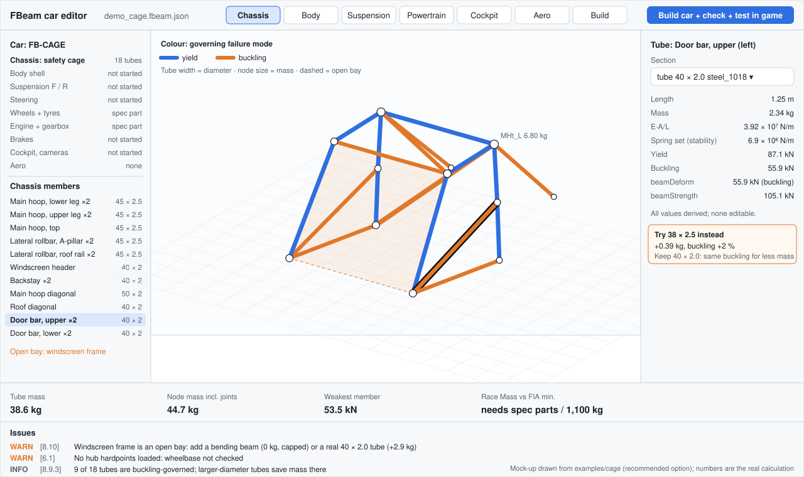

# FBeam car editor: design

**The editor builds the whole drivable BeamNG car from an engineering model.** The team designs tubes, suspension hardpoints, panels and components. The editor generates every jbeam part, the part config, the vehicle info file and simple meshes, as a mod folder ready to load in BeamNG. Anything a rule limits is computed, never typed by hand, so the car passes the FBeam rules by construction.



*Mock-up drawn from the real cage calculation in `examples/cage`: tubes coloured by failure mode, the selected door bar's derived values, and the full-car tree on the left. Regenerate with `python docs/img/make_editor_mockup.py`. A working prototype is in `editor/` (section 7.1).*

## 1. What already exists

BeamNG publishes two general jbeam editors, both MIT-licensed. FBeam should not rebuild them; it adds what they cannot know: that a beam is part of a steel tube, and that the car has to meet a rulebook.

| Tool | What it does | What FBeam takes from it |
| --- | --- | --- |
| [BeamNG Blender JBeam Editor](https://github.com/BeamNG/Blender-JBeam-Editor) (Blender 4.2+) | Imports jbeam parts and whole vehicles from a `.pc`. Nodes are mesh vertices and beams are edges. Edits nodes, beams, triangles and quads, with live text sync, and exports with minimal changes to the source file. Creating jbeam from scratch is on hold ([user docs](https://github.com/BeamNG/Blender-JBeam-Editor/blob/main/docs/user/user_docs.md)). | An optional route for detailed body meshes. FBeam reads donor parts itself with its own parser. |
| [BeamNG VS Code JBeam Editor](https://github.com/BeamNG/vscode-jbeam-editor) | Text editing with a 3D preview and symmetry checks. Its "simconnection" links to a running game and shows processed variables and active parts. | Checking the generated car against what the game actually built. |
| [BeamNG Basic Car Tutorial](https://documentation.beamng.com/modding/vehicle/tutorials/basic_car_tutorial/) | Builds a drivable kit car by reusing vanilla suspension and drivetrain. They attach through predefined node names: `em1r`/`em1l` engine mounts, `tra1` transmission, `fx1/2r/l` front and `bx1/2r/l` rear suspension mounts. | The pattern for the donor interface (section 4). |
| Community: [NodeBeam Editor](https://github.com/RORMasa/NodeBeamEditor), [nodeSnap](https://www.beamng.com/threads/nodesnap-new-jbeam-editor.76732/), [jbeam_edit](https://github.com/webdevred/jbeam_edit) | Node and beam editing; a command-line jbeam formatter. | Nothing needed now. |

## 2. Principle: rules by construction

1. **The design model is the source of truth, not the jbeam.** It holds the car in one `.fbeam.json` file: tubes, hardpoints, panels, components and settings. Every jbeam part is generated from it and marked "generated, do not edit".
2. **Every rule-bound value is derived.** The user sets geometry, sections, component choices and design margins. The editor computes node masses, beam limits, spring caps, suspension travel, brake torque, aero coefficients and dimensions. They appear as read-only values with the rule that produced them.
3. **Three levels of enforcement.**

| Level | When | Examples |
| --- | --- | --- |
| Impossible by construction | While editing | A structural beam without a section; a node lighter than its tubes; a tube below the FIA minimum for its role; brake torque above the cap; a wing outside the aero box; editing a sealed spec part |
| Live warning | On every change | Near buckling; suspension travel under 150 mm; car outside the size envelope; Race Mass or CoG against targets; stability forcing very low springs |
| Global check | On demand, and before export | Frame model vs jbeam load cases (8.10.6); a full `fbeam_checker` run; later, the in-game test harness |

4. **One engine.** The editor, the checker and CI call the same Python code, so they cannot disagree.

## 3. What a complete BeamNG car needs, and who makes it

A vehicle is a mod folder, `mods/unpacked/<mod>/vehicles/<model>/`, holding jbeam parts, part configs, `info.json`, meshes and materials ([mod structure](https://documentation.beamng.com/modding/vehicle/tutorials/basic_car_tutorial/), [configs and info files](https://documentation.beamng.com/modding/vehicle/tutorials/configs/)). The root part has `slotType: "main"`, and one set of `refNodes` must exist or the car will not spawn ([refNodes](https://documentation.beamng.com/modding/vehicle/sections/refnodes/)).

| Car element | jbeam sections | Made by | Rules built in |
| --- | --- | --- | --- |
| Main part and slot tree | `information`, `slotType: main`, `slots` | Generated | Spec slots filled with spec parts only (4, 5) |
| Chassis and cage | `nodes`, `beams` with `fbeamSection` | Tube model | Mass-strength rule (8.3), FIA cage minimums (8.9.1), bending beams (8.10) |
| Body shell and panels | `nodes`, `beams` (`sheet` sections), `triangles`, `flexbodies` | Panel model on the tubes; simple generated meshes, or the team's own mesh | Sheet rule (8.5), closed roof (6.7), envelope and arches (6.2–6.6) |
| Reference nodes, cameras | `refNodes`, cameras | Generated from the cockpit and chassis | Always present, so the car spawns |
| Suspension F / R | `nodes`, `beams` (arms), spring and damper beams, `torsionbars` (anti-roll bars) | Hardpoint model: pickup points, spring and damper curves | Travel ≥ 150 mm by kinematic sweep (7.1.1); passive only (7.1.5); arms follow the tube rule (7.1.3) |
| Steering | `hydros` or rack `rails` and `slidenodes`, steering stops | Rack position, ratio, lock | Mechanical front steering with stops; no rear steer (7.2) |
| Wheels, hubs, tyres | `pressureWheels` via the spec tyre part | Spec part, attached to generated hub nodes | Sealed tyre fields (5.2); pressure window as the only variable (5.3); 650 mm limit (6.8) |
| Brakes | brake torque on the wheel parts, handbrake | Values from the brake panel | Torque caps (7.3.2), rear-only handbrake (7.3.3), no ABS (7.3.5) |
| Engine, gearbox, final drive, differential | `powertrain` via spec parts | Spec parts in their slots; mount and shaft nodes generated | Sealed (4.2); final drive from the allowed set (4.5); LSD settings in range (4.6) |
| Fuel tank | spec tank part | Placed in the chassis | 10 L at weigh-in (4.7) |
| Cockpit | seat, driver ballast, pedals, camera | Cockpit panel | 75 kg driver ballast, CoG ≥ 250 mm (6.7) |
| Aero | `triangles` with `dragCoef`, `liftCoef` | Wing and splitter tools | Aero box (7.4.2–7.4.3), coefficient limits (7.4.5), fixed only |
| Ballast | solid nodes on the cockpit floor | Ballast tool | Declared ballast only (6.10) |
| Controllers | `controller` | Only the allowed list | No TC, ABS, launch control (7.5) |
| Part config, info, manifest | `.pc`, `info.json`, `fbeam.json` | Generated | Tuning variables within range (9.1); car passport inputs (10) |

## 4. The donor interface

The spec engine, gearbox, tyres and fuel tank come unmodified from one vanilla car (recommended: Ibishu Covet NGRC2). Vanilla parts attach to their host car through **named nodes and slot types**. The official tutorial's reused parts, for example, expect `em1r`/`em1l`, `tra1`, `fx1/2r/l` and `bx1/2r/l`. So the editor must generate a car that offers exactly what the spec parts expect:

- **Interface file.** A `donor_interface.json` for the chosen car: every node name the spec parts reference, its role (engine mount, transmission, hub, driveshaft end), its donor position, and every slot type and slot name to fill. It is extracted once from the donor's jbeam files with the checker's parser.
- **Hardpoints travel with their part.** Each spec part's interface nodes form a rigid group. The team does not edit them one by one; it places the whole part (4.1 below), and the group moves with it. The team then connects the group to the structure with mount tubes.
- **Validation.** A car without every interface node, or with a spec part in the wrong slot, cannot be built.

This is also what keeps spec parts sealed: the editor references them by slot and never copies or rewrites them.

### 4.1 Placing engine, gearbox and driveline

The team decides where the power unit sits and how it reaches the wheels. The spec parts stay sealed inside.

- **Engine and gearbox as one rigid block.** Move it in the viewport, like a real engine on a hoist. The block keeps the donor's orientation (transverse on the Covet). Its position must satisfy rule 4.4: front-engine, with the block centre no more than 200 mm behind the front axle line. The limit is drawn as a zone.
- **How placement reaches the game.** The part's nodes move without editing its file: the main part's slot entry for the spec part carries a node offset. This must be confirmed in-game for each spec part; if a part cannot be offset, its position is fixed at the donor's and the car is built around it.
- **Mounts are the team's design.** Engine and gearbox mounts are drawn as tubes or brackets from the block's mount nodes to the frame. They follow the mass-strength rule, and mount stiffness is a visible setting.
- **Driveline.** The differential output and the hub positions set the halfshafts. The editor draws them, and runs the suspension sweep to show the CV-joint angle and plunge (length change) over full travel. It warns when either passes the donor part's limits, so a pickup-point change that breaks the driveline shows up at once.
- **Other components** (fuel tank, radiator, battery, driver seat) are placed the same way: a rigid block, a rule zone, and team-drawn mounts. Every placement feeds the live mass, CoG and weight-distribution figures.

## 5. Design model

| Object | Fields | Generated |
| --- | --- | --- |
| Joint | id, position, type (welded / bolted / pin), mirror flag | Node; mass = tube shares × 1.15 |
| Tube | joint path (bends allowed), section, material, role | Member beams with `fbeamSection`, `fbeamMember`; bend chords |
| Bend | radius, at least 3 × D (FIA) | Chord nodes along the arc; not bracing points for buckling |
| Opening | the loop of tubes around it (found automatically) | Nothing, a budgeted bending beam, or a real tube |
| Panel | sheet thickness, boundary tubes, mesh (generated or imported) | Shell beams with `sheet` sections, collision triangles, flexbody |
| Suspension corner | type (double wishbone, MacPherson, multilink, trailing arm, beam axle); pickup points (inner and outer arm joints, tie rod, damper top and bottom, spring seats, ARB links); arm sections; spring rate; damper curve; bump stops; ARB | Arm beams (tube rule), spring and damper beams, torsion bar, upright and hub nodes |
| Steering | rack mount, ratio, lock | Rack hydro or rail, stops |
| Brakes | torque front and rear, bias, handbrake | Values on the wheel parts |
| Power unit and components | spec part slot (engine + gearbox, tyre, tank), placement (position of the rigid block), mounts | Slot entry with node offset; interface nodes moved as a group; mount tubes |
| Driveline | diff output, halfshaft ends at the hubs | Checked against CV angle and plunge over travel; donor final drive and diff settings from the allowed set |
| Cockpit | seat position, driver ballast, camera | Ballast part, internal camera, refNodes |
| Aero device | wing or splitter outline, angle | Triangles with coefficients inside the aero box |
| Ballast | mass, position on the floor | Declared ballast nodes |
| Envelope | Covet size box, arch limit, ground clearance plane | A live constraint only |
| Symmetry | mirror plane X = 0 | Left and right generated together, mirrored names |

Node and beam names are deterministic (for example `mh_t_L`), so a small design change gives a small jbeam diff and a predictable hash.

## 6. What the user sees

Workspaces follow the car: **Chassis, Body, Suspension, Powertrain, Cockpit, Aero, Build.** The mock-up above shows Chassis.

- **3D viewport.** Tubes are drawn as tubes, their thickness scaled to diameter. A colour mode switch shows:
  - utilisation;
  - governing failure mode (yield or buckling);
  - mass per metre;
  - rule status.

  Nodes scale with mass, and openings are shaded. The size envelope, the aero box and the ground-clearance plane are wireframes that turn red where the car crosses them. Donor and spec parts are shown in grey and are read-only.
- **Chassis.** Joint, Tube, Bend, Brace and Measure tools, with symmetry on and snapping to hardpoints. The tube inspector shows derived values and previews a section change before it is applied, for example "40 × 2.0 → 38 × 2.5: +0.39 kg, buckling +2 %". The Brace tool shows the cost of stiffening a bay at the moment of choosing: a bending beam at 0 kg but capped, or a real tube with its mass.
- **Suspension.** Choose the corner type, then drag each pickup point: inner and outer arm joints, tie rod, damper and spring mounts, ARB links. Inner pickups snap to frame tubes and create welded joints there, so the frame carries the suspension loads it really would. Live curves over full wheel travel:
  - camber, toe (bump steer) and caster;
  - roll-centre height;
  - motion ratio and wheel rate;
  - halfshaft angle.

  The travel check against 150 mm, bump-stop contact, and the spring and damper settings are shown as they will be exported. Arms are tubes and follow the chassis rule.
- **Body.** Panels are stretched over the cage. Thickness sets mass and strength through the sheet rule. Import a custom mesh, or use simple generated panels.
- **Powertrain.** The engine and gearbox block, fuel tank and radiator are placed in the viewport, inside their rule zones. Mounts are drawn to the frame, and halfshafts are checked over travel (4.1). Other settings offered are only those the rules leave open: final drive from the allowed set, and LSD preload and locking within their ranges.
- **Cockpit and Aero.** Seat and driver ballast with the CoG line; wing and splitter outlines constrained to the box.
- **Build.** Generates the mod folder, runs the full checker, and shows the budget:
  - structure mass and estimated Race Mass against the FIA minimum;
  - ballast left and CoG height;
  - wheelbase and track.

  It then copies the mod to the BeamNG mods folder and reloads the car. The VS Code simconnection, and later the FBeam harness, confirm what the game actually built.
- **Always visible.** The budget bar and an issues panel. Issues give the rule number and plain words, clicking one selects the part, and the wording is the checker's own.
- **Load cases.** Torsion, vertical bending, sideways at the main hoop and roof load. Exaggerated deformation, stiffness numbers and the weakest member, for the frame model and the jbeam model side by side.

## 7. Architecture: an HTML app running the Python core

The editor is a web page. three.js draws the 3D view, and the engineering runs as Python inside the browser through [Pyodide](https://pyodide.org) (Python compiled to WebAssembly). `fbeam_checker` uses only the standard library, so the page runs **the same code** as the command line, CI and the scrutineers, unchanged.

```
Browser page (editor/index.html, app.js)
  three.js viewport       tubes, joints, pickup points, engine block, envelope
  HTML panels             workspaces, inspector, budget bar, issues
      |  calls (JSON in, JSON out)
  Pyodide: Python in WebAssembly
    fbeam_design  (pure Python, standard library)
      model.py         the car model: tubes, panels, suspension, components
      donor.py         donor interface extraction and hardpoints
      chassis.py       tube -> nodes/beams, masses, limits, stability-capped springs
      openings.py      open bays, bending-beam budgets
      suspension.py    corner geometry, kinematic sweep, springs and dampers
      body.py          sheet panels, triangles, simple meshes
      vehicle.py       main part, slots, refNodes, cameras, .pc, info.json, mod folder
      frame.py         3D beam-element solver for the load cases
    fbeam_checker (existing): sections, rules file, checks, hashes
      |
  Output: the mod as a .zip download, or written into the BeamNG mods folder
```

- **The page only draws and edits the model.** Every number it shows comes back from the Python core; JavaScript never computes a rule-bound value.
- **Nothing to install.** Entrants open a link, and it can be hosted on GitHub Pages from this repository. Everyone gets a new rules version at the same time.
- **Files.** The mod folder is built with Python's own `zipfile` and downloaded. In Chrome and Edge, the File System Access API can write it straight into the BeamNG mods folder once the user picks that folder.
- **Donor parts.** The user picks the game's vehicle zip (for example `covet.zip`) in the page, and the core's jbeam parser extracts the donor interface and reference geometry. Nothing from the game is uploaded or redistributed.
- **Meshes.** Simple meshes for tubes, panels and the wing are generated as `.dae`. Detailed custom bodies still come from Blender or another modeller, imported as a mesh and bound to the generated nodes.
- **Game connection.** A browser cannot open the socket BeamNG's VS Code extension uses. Checking against the running game goes through the in-game FBeam harness, or a small local helper later.

**Why HTML rather than Blender.** Blender was the first idea, because it runs Python and has mesh tools. Pyodide removes the Python argument, and for a public competition, a link that opens anywhere matters more than Blender's modelling. Blender stays an optional route for detailed body meshes.

### 7.1 Prototype (working)

`editor/` holds a working prototype. It opens a complete Covet-size tube-frame chassis (114 tubes, 50 joints: cage, sills, floor, and front and rear subframes with strut towers, in Covet coordinates; every pickup a braced joint, rule 7.1.6; the spec engine's attachment joints named and placed as on the Covet), with ghost wheels (165/70R14) and the size envelope.

- **Draw.** Joint, Tube, Split and Delete tools on a work plane (horizontal, side or front) through the selected joint, with 10 mm snapping. Joints and tubes are picked by screen distance, so thin tubes are easy to hit.
  - Symmetric editing mirrors joints, tubes, splits and deletes.
  - Undo, and save and open as `.fbeam.json`.
  - New tubes get the default section for their role: chassis frame, cage main or cage other.
- **Rules by construction.**
  - Only sections at or above the FIA minimum are offered for cage roles.
  - Duplicate or zero-length tubes are refused.
  - Joints with no tubes are left out of the build and reported.
  - A tube split at a joint that nothing else braces keeps the buckling length of the whole run (8.9.7), so splitting never makes a tube stronger. A real brace at the joint shortens it.
- **Inspect.** Every tube's derived values, with the buckling length, and a preview table of every allowed section. Joint position, and axle reference (front or rear).
- **Centre of gravity.** Structure CoG from node masses: height, fore-aft position, front/rear split between the axle joints, and lateral offset, with a marker in the view.
- **Rigidity** (`editor/fbeam_frame.py`, a 3D beam and truss solver in plain Python, checked against 3EI/L³, EA/L and GJ/L).
  - Torsion: rear axle held, front axle twisted. Bending: axles held, load at mid-wheelbase.
  - Three models: the real welded frame, the same tubes pin-jointed, and as BeamNG will run it (pin joints, stability-capped springs).
  - Pin-jointed mechanisms are counted and the joints are marked. A live Maxwell count (3N − 6) shows how many tubes short of rigid the frame is.
- **Tubes or jbeam.** A view switch shows the design tubes, the exported jbeam (nodes sized by `nodeWeight`, beams as lines), or both. The tube inspector shows the exact exported beam row and its end node weights.
- **Suspension workspace** (`editor/fbeam_suspension.py`, pure Python).
  - **Layouts:** MacPherson strut, double wishbone, five-link (multi-link), trailing arm, semi-trailing arm, trailing arm with lateral links, twist beam, and solid axles (4-link with a Panhard rod, 4-link with a Watt's linkage, triangulated 4-link) and de Dion axles (with a Watt's linkage or a Panhard rod). Each corner picks its layout from a list; switching lays the new layout out around the same wheel centre with a sensible start (bump steer under 0.6°, at least 150 mm of travel), and one button puts frame joints at its free pickups. Corners are defined for the left side and mirrored. Pickup points are coordinates, or references to chassis joints that move with the frame.
  - **Solver:** one solver for every layout. The upright is a rigid body with six degrees of freedom, constrained by the layout's links: rods (one ball joint at each end), A-arms (two rods to one ball joint), a strut (axis through the top mount), a pivot axis (the hub rigid with a trailing or semi-trailing arm), a ball bush, or the line through both bushes of a twist beam. A solid or de Dion axle is one rigid body carrying both hubs (a de Dion adds halfshafts from its chassis-mounted differential, analysed for angle and plunge): its links are used on both sides, the Panhard rod or Watt's linkage once (Watt's as a straight-line constraint on its centre pivot), both wheels are driven together, and its roll centre is the height of the lateral locator. The wheel centre is driven through the travel and the pose solved by damped Gauss-Newton. A new layout is a data entry in `TOPOLOGY`, not new code.
  - **Derived for any layout:** the steering axis is the axis the upright turns about when the rack moves (the ball-joint line for a double wishbone, a virtual axis for a multi-link); the roll centre comes from the contact patch's sideways motion in heave, which equals the front-view instant-centre construction for planar layouts and stays exact for 3D ones.
  - **Over wheel travel:** camber, toe (bump steer), track change, roll-centre height from the front-view instant centres, motion ratio from the damper length, wheel rate (spring × MR²), and halfshaft angle and plunge.
  - **Static:** kingpin inclination, caster, scrub radius and mechanical trail.
  - **Rule checks:** usable travel from the damper stroke against 150 mm (7.1.1); the front must steer (7.1.2); every inner pickup on a frame joint braced in three dimensions (7.1.6), with one-click attach to the nearest joint; track plus tyre within the arch width (6.4).
  - **UI:** a travel slider moves both wheels through heave in 3D, with charts that mark the current travel and the usable band.
  - **Example:** front MacPherson on the Covet points: 158 mm usable travel, 68 N/mm wheel rate, 46 mm roll centre, 0.33° bump steer over ±60 mm. Rear double wishbone: 223 mm, 13 N/mm, 71 mm roll centre, 0.9° bump steer.
  - **Export:** every layout writes its links as member tubes and the upright as one rigid body; trailing arms are tubes from the pivots to the hub, a twist beam two cross tubes between the hubs (its roll stiffness not yet tuned), a solid axle one rigid body with both hubs, its links on both sides and the Panhard rod or a real Watt's linkage (rocker hinged on the axle, two rods to the chassis) once. SVJ uses `multi_link`, `trailing_arm`, `semi_trailing_arm`, `torsion_beam` `solid_axle` and `de_dion`, valid against the official schema and lossless on re-import.
- **Driveline** (`editor/fbeam_driveline.py`, Components workspace). FWD (the spec: the Covet's gearbox differential and unequal halfshafts), or RWD / AWD for testing (4.6 warns). Draws the differentials, halfshafts and propshaft in 3D, following the wheels at the current travel. For every shaft: static and maximum joint angle and the plunge over the usable travel, warned above about 25° (CV joints), 12° (propshaft) and 40 mm of plunge. A live axle carries its differential, so its propshaft runs to a pinion that moves with the axle; a de Dion's halfshafts start at its chassis differential. SVJ `vehicle_info.drive_type` follows the layout.
- **Components workspace** (`editor/fbeam_mass.py`). Engine + gearbox, driver ballast, fuel, cooling, exhaust, battery, seat, steering rack, body panels and ballast are boxes with mass, CG and size. Unsprung mass sits at each wheel centre.
  - **Whole car:** mass, CG, front/rear and left/right split, and roll, pitch and yaw inertia about the CG, by the parallel-axis theorem. The structure is its jbeam node masses as point masses, exactly as BeamNG will simulate it.
  - **Rules:** 4.4 engine position, 4.7 fuel present, 6.7 driver 75 kg with CG ≥ 250 mm, 6.10 ballast on the floor, 6.11 minimum Race Mass with the ballast still needed.
  - **SVJ:** everything goes to `mass_bodies`, `mass_unsprung_per_corner`, `center_of_gravity` and `inertia`; bodies plus unsprung sum to `mass_total` (§7.2.2). SVJ `mass_bodies` import as components (box size recovered from the inertia).
  - **Example estimates:** 564 kg total (102 structure, 317 components, 144 unsprung), CG 438 mm, 60 % front. That is 536 kg under the 1,100 kg FIA minimum.
- **SVJ.** Import and export of Standard Vehicle JSON (`editor/fbeam_svj.py`). Export is valid against the official schema, and the FBeam round trip is lossless. Importing any SVJ gives a skeleton of pickup joints and its corners. See [svj.md](svj.md).
- **Build.** Writes the jbeam and the manifest (with the axle joints, so the wheelbase is checked), runs the official checker, and offers the mod zip for download. The suspension is analysed but not exported to jbeam yet.

Measured in the browser for the full chassis: engine load 1–3 s, evaluation about 5–20 ms, suspension analysis about 0.2 s (run only in its workspace), rigidity about 0.5 s, build plus check about 60 ms.

**First engineering result.** The example chassis is about 2,820 N·m/° in torsion and 7,640 N/mm in bending as a welded frame. Pin-jointed, it has 30 mechanisms and effectively zero stiffness. That is exactly the shortfall Maxwell's rule predicts: a rigid pin-jointed space frame needs at least 3N − 6 tubes, so 50 joints need 144, and it has 114. So a realistic welded chassis is not rigid in jbeam without bending beams or extra real tubes. Automatic, budgeted corner bending beams (8.10.3) followed from this, and the editor now generates them.

Run it from the repository root:

```
python -m http.server 8000
```

Then open http://localhost:8000/editor/. The engineering behind it is `editor/fbeam_editor_core.py`, tested in `tests/test_editor_core.py`.

## 8. Milestones

1. **Prototype.** Done: full chassis in 3D, drawing tools, tubes and jbeam views, sections, joints, CoG, rigidity (three models), suspension kinematics, build and check in the browser.
   - **Also done:** automatic budgeted bending beams (with checker support), steering and roll analysis, Components, Aero and Body workspaces, SVJ and glTF meshes, and the full-car export (suspension part, refNodes, info.json).
   - **Left, needs BeamNG:** donor interface and spec part names, wheels via the spec tyre part, steering hydro, powertrain attachment, and calibration of aero, tyre and stability numbers.
2. **Donor interface.** Pick the donor car in-game, extract `donor_interface.json` (node names, slots, positions), and confirm the spec part names in `rules/fbeam_v1.json`.
3. **Minimum drivable car.** `.fbeam.json` → a mod folder with the tube chassis, donor-compatible hardpoints, spec powertrain and tyres, and simple suspension, steering and brakes. It must spawn and drive. Built by the Python core, usable from the command line and the page.
4. **Checker catches up.** `fbeamRole`, `fbeamMember` grouping, the bending-beam end rule and budgets, suspension travel and brake caps from the model.
5. **Frame solver and suspension kinematics.** The four load cases, and the travel, camber and roll-centre sweeps. Check they stay fast enough in Pyodide.
6. **Editor, full chassis workspace.** Draw joints and tubes (not only edit them), bends, openings and the Brace tool, save and load `.fbeam.json`, and hosting on GitHub Pages.
7. **Remaining workspaces:** Suspension, Body, Powertrain, Cockpit, Aero.
8. **Game loop.** Write into the mods folder, reload in game, and confirm with the FBeam harness (Race Mass, ride height, travel, brake, impact tests).

## 9. Risks

- **Donor parts expect more than node names.** Spec parts may also rely on node groups, slot variables or companion parts. The interface extraction must list everything they reference, and the minimum-car milestone proves it.
- **Browser limits.** Pyodide adds several megabytes on first load (then cached), and Python in WebAssembly is slower than native. The prototype is well within budget, but the frame solver and suspension sweeps must be timed as they grow; heavy maths could move to a Web Worker so the view stays smooth.
- **Stability vs realism.** Short chords in bends and light suspension arms need heavy enough nodes to stay stable, and the rules set node mass. The generator should use the fewest chords that respect the bend radius, and warn when the stability cap is very low.
- **Body shells and meshes.** A full stamped unibody is hard to express as panels on tubes. Start with a tube-frame silhouette body and simple panels; full unibody modelling comes later.
- **Unverified BeamNG numbers.** The 2,000 Hz physics rate, donor node names and spec part data must be confirmed in-game before release.
