# FBeam editor manual

The FBeam editor designs a BeamNG.drive car that obeys the FBeam technical regulations. You draw a tube frame, lay out the suspension, place the heavy parts, shape the body and add aero. The editor checks the rules as you work and writes the finished car as a BeamNG mod. You can also start from a vanilla BeamNG vehicle and modify it as the game's own Vehicle Config menu does.

Every number on screen comes from the same Python code the scrutineers' checker runs. What the editor shows as legal is legal at inspection.

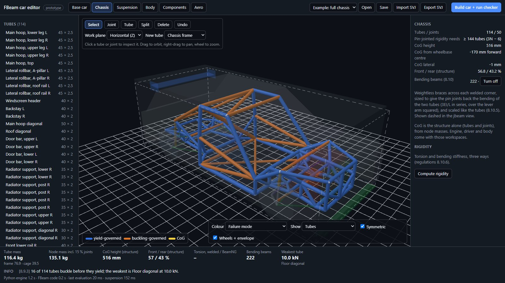

## Contents

1. [Starting the editor](#1-starting-the-editor)
2. [The window](#2-the-window)
3. [How the editor works](#3-how-the-editor-works)
4. [Base car: start from a vanilla vehicle](#4-base-car-start-from-a-vanilla-vehicle)
5. [Chassis: the tube frame](#5-chassis-the-tube-frame)
6. [Suspension](#6-suspension)
7. [Body](#7-body)
8. [Components and driveline](#8-components-and-driveline)
9. [Aero](#9-aero)
10. [Building the car and the checker](#10-building-the-car-and-the-checker)
11. [SVJ: import and export](#11-svj-import-and-export)
12. [Saving and opening](#12-saving-and-opening)
13. [Keys and mouse](#13-keys-and-mouse)
14. [Troubleshooting and limits](#14-troubleshooting-and-limits)

## 1. Starting the editor

The editor is a web page. It needs no installation, but it has to be served over http from the repository root, so the page can load the Python files next to it.

```bash
python -m http.server 8000
```

Then open `http://localhost:8000/editor/` in Chrome, Edge or Firefox. The first load downloads the Python engine (Pyodide, from a CDN), which takes a few seconds. After that the example car opens: a Covet-size tube frame with a MacPherson front, a double wishbone rear, a body shell, components, a rear wing and a splitter.

**Example** (top right) switches between the full example, the safety cage on its own, and an empty model.

## 2. The window

| Area | What it holds |
| --- | --- |
| Header | The workspaces (Base car, Chassis, Suspension, Body, Components, Aero), the example menu, Open, Save, Import SVJ, Export SVJ, and **Build car + run checker** |
| Left panel | What the workspace lists: tubes and joints, suspension points, components, aero devices, or vehicles |
| 3D view | The car. **Drag** to orbit, **right-drag** to pan, **wheel** to zoom. The toolbar at the top changes with the workspace. |
| View options (bottom of the view) | **Colour**: failure mode, frame / cage, allowed load, mass per metre. **Show**: tubes, jbeam (nodes + beams) or both. **Symmetric**: edits apply to both sides. **Wheels + envelope**: ghost wheels and the size limits. **SVJ meshes**: imported glTF meshes, when there are any. |
| Right panel (inspector) | Details and settings of whatever is selected, or the workspace summary |
| Budget bar (bottom) | The key figures of the workspace: mass, CoG, travel, roll centres, downforce and so on |
| Issues | Every rule check, newest first: **PASS**, **INFO**, **WARN** or **ERROR**, with the regulation number in brackets |

The last line shows how long each Python step took, which helps when a change feels slow.

## 3. How the editor works

- **The model is the design.** Everything is kept in one model: joints, tubes, suspension corners, components, body, aero and driveline. Save writes it as a `.fbeam.json` file. The jbeam is generated from it when you build, so never edit the jbeam by hand.
- **Rules by construction.** You choose a tube section from a catalogue, and the editor derives everything else from it: stiffness, yield and buckling limits, mass and node weights. A cage tube can only be chosen from the sizes FIA Appendix J allows.
- **Left side, mirrored.** Joints named `_L` and `_R`, and BeamNG-style `l` / `r` and `ll` / `rr`, are mirror pairs. Suspension corners are defined on the left and mirrored to the right. With **Symmetric** on, every edit applies to both sides.
- **Axes.** BeamNG's: X to the left, Y to the rear, Z up, in metres. The example sits in the Covet's own coordinates, with the wheels at Y = ±1.25 m.
- **Undo.** **Ctrl+Z** undoes the last change, up to 100 steps back, in every workspace.

## 4. Base car: start from a vanilla vehicle

The Base car workspace reads a vanilla BeamNG vehicle from **your own install** and lets you modify it as the game does. Nothing from the game is part of FBeam: the files are read in your browser and never uploaded.

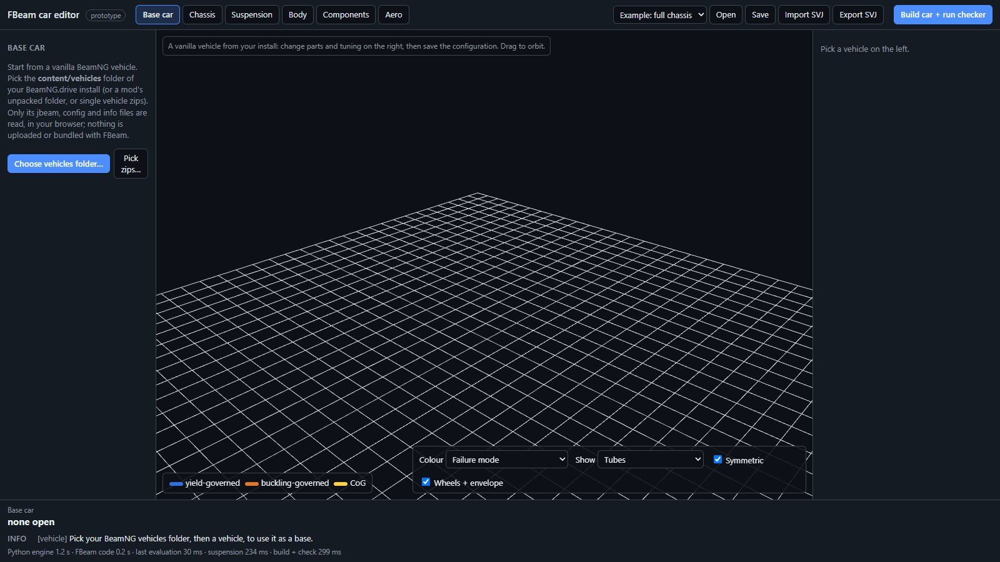

1. Click **Choose vehicles folder…** and pick `BeamNG.drive/content/vehicles` from your install. A mod's unpacked folder also works, or **Pick zips…** for single vehicle zips. Include `common.zip`, which holds the wheels, tyres and other shared parts.
2. The vehicle list appears, cars first; type in **Filter** to narrow it. Only each zip's small text files are read (jbeam, configs, info), not its meshes, so a full install takes about 10–15 s.
3. Click a vehicle. The first one also loads the shared parts, which takes a few seconds once per session.

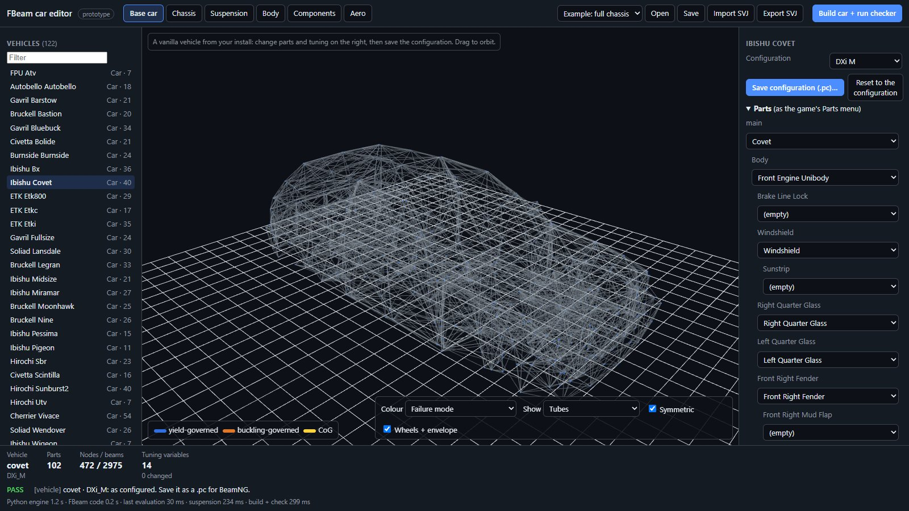

| Panel | What it does |
| --- | --- |
| Configuration | One of the vehicle's own configurations (`.pc`), as in the game's vehicle selector |
| Parts | The parts tree, as the game's Parts menu. Every slot has a menu of the parts that fit it, plus "(empty)" unless the slot must be filled. Choosing a part rebuilds the tree below it. |
| Tuning | The tuning variables of the active parts, as sliders grouped by category (Brakes, Chassis, Engine, Wheels, Wheel Alignment ...) and Front / Rear. Sliders that feed positions, such as track width, move the 3D view too. |
| Save configuration (.pc)… | Downloads your configuration. Put it in your BeamNG user folder under `vehicles/<model>/` and it appears in the game's vehicle selector. |
| Reset to the configuration | Drops your changes |

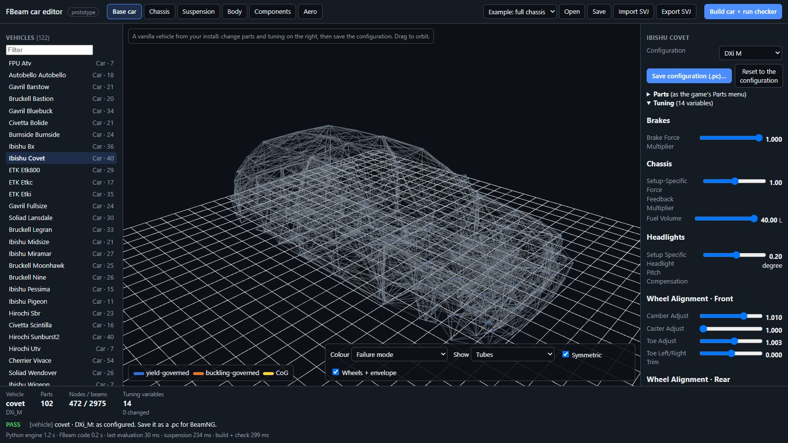

The 3D view shows the vehicle's node-and-beam structure. Body meshes and paint are not drawn yet. Parts a configuration names that are not in the picked files are listed as missing (pick the whole folder, `common.zip` included).

## 5. Chassis: the tube frame

### Looking at a tube

Click a tube in the view or in the list. The inspector shows everything derived from its section:

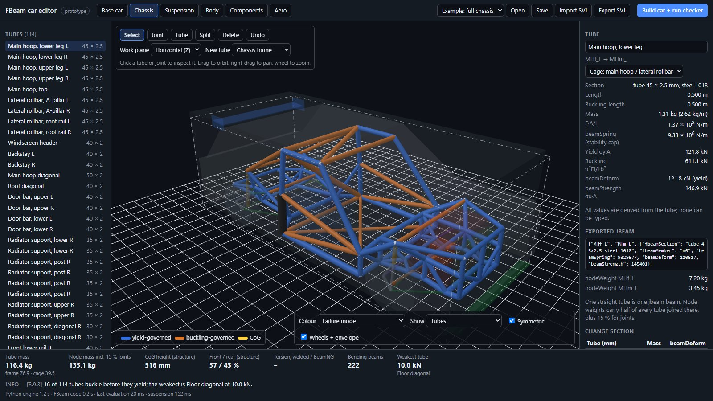

- **Length and buckling length.** A tube split at a joint that nothing braces buckles over the whole run (8.9.7).
- **Mass and E·A/L,** with the beamSpring BeamNG can actually run, capped for stability at 2,000 Hz physics (8.9.6).
- **Yield and buckling loads,** and beamDeform (the lower of the two) and beamStrength. The colour tells you which governs: blue for yield, orange for buckling.
- **The jbeam row** the build writes, and the node weights at its ends.
- **Change section:** every allowed section with its mass and strength change. Click one to apply it.

Click a joint to see its position (editable) and the tubes it joins.

### Drawing

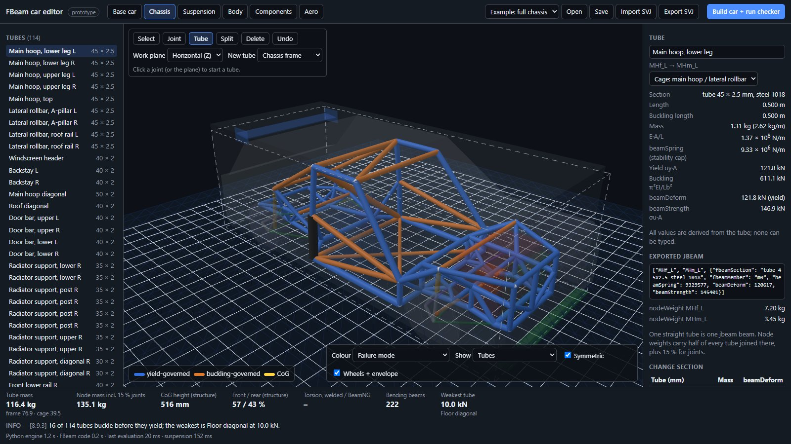

| Tool | Key | Use |
| --- | --- | --- |
| Select | S | Pick tubes and joints |
| Joint | J | Click the work plane to place a joint (10 mm grid); with Symmetric on, its mirror appears too |
| Tube | T | Click two joints, or empty space for a new joint, to draw a tube; keep clicking to chain. **Esc** ends the chain. |
| Split | P | Click a tube to put a joint in it |
| Delete | D or Del | Click a joint or a tube (and its mirror) |

- **Work plane:** horizontal, side or front, through the selected joint. New joints land on it.
- **New tube:** chassis frame, cage "other" member or cage main hoop. It sets which sections the tube may use.

### Seeing the jbeam

**Show → Both** draws the jbeam over the tubes. Member beams lie on the tubes; the dashed lines are **bending beams**. A jbeam joint is a pin, so a frame of tubes alone folds in BeamNG. Bending beams are weightless braces across each welded corner, sized from the real tubes' bending (8.10.3), and scaled like the tubes. They give the pin joints back exactly the stiffness and strength the welded frame has, never more. **Turn off** in the summary removes them.

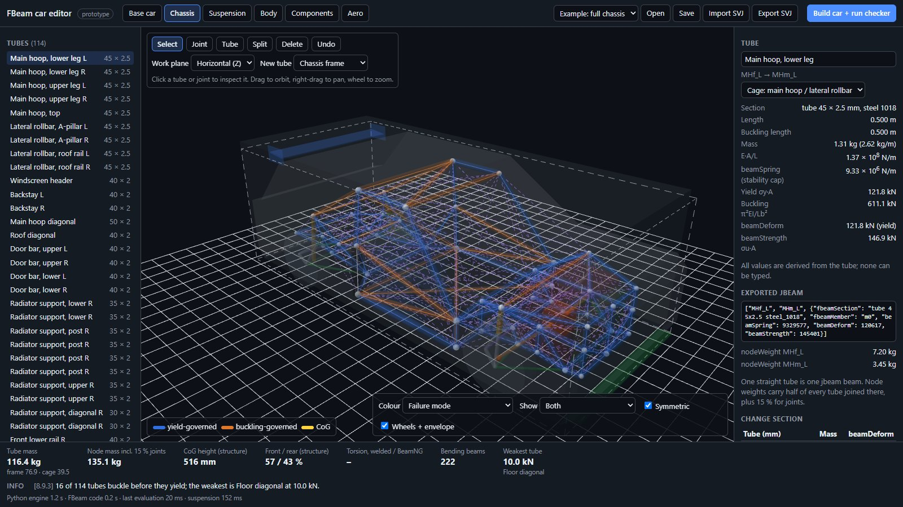

### Rigidity

Click empty space to see the chassis summary. Then **Compute rigidity**, which takes a second or two:

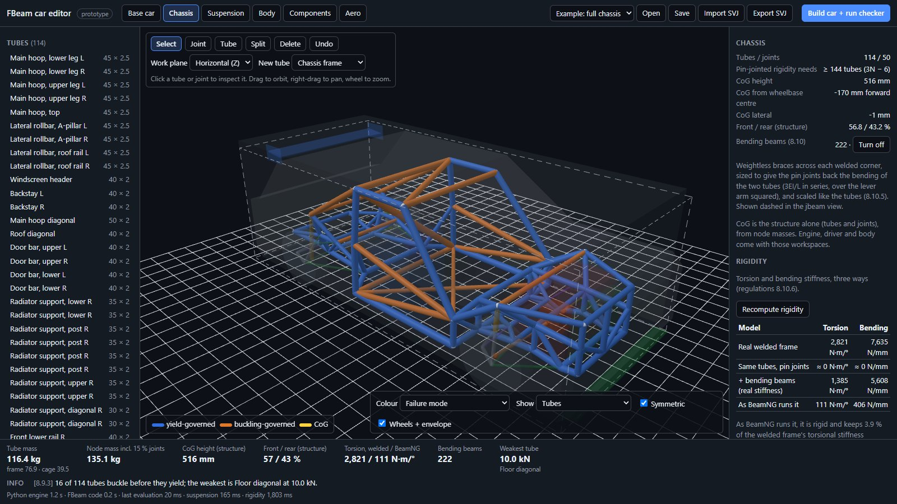

| Model | What it means |
| --- | --- |
| Real welded frame | The tubes with real bending: what the car would be in steel |
| Same tubes, pin joints | Triangulation alone. Near zero means the frame folds: the summary counts the missing beams (Maxwell's rule, 3N − 6). |
| + bending beams | Pins plus the budgeted bending beams at real stiffness: must not beat the welded frame by more than 10 % in any of the four 8.10.6 load cases (torsion, bending, sideways at the hoop top, roof) |
| As BeamNG runs it | With the stability-capped springs: what you will feel in game |

## 6. Suspension

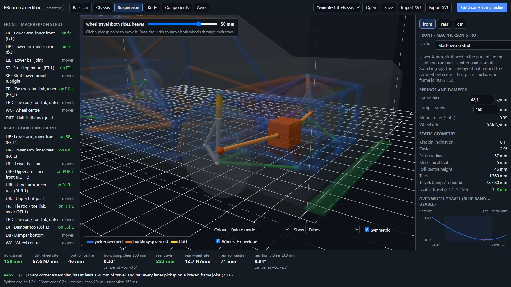

The left panel lists every point of the front and rear corners. **Inner pickups** must sit on a frame joint braced by at least three tubes not all in one plane (rule 7.1.6). Green means they do; red or orange means they don't. **Moving points** (ball joints, uprights, wheel centre) move with the wheel.

- **Wheel travel** (toolbar slider) moves both wheels through bump and rebound, with the halfshafts following.
- **Click a point** (in the view or the list) to edit it. A free point can be typed in or **Attached to joint**; an attached one moves with its joint, or can be **Detached**.

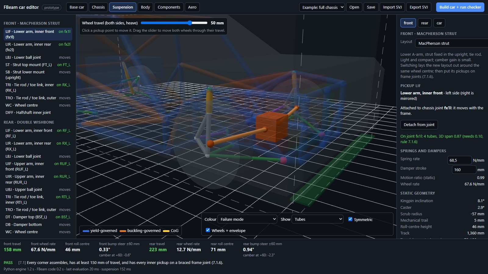

### Layouts

**Layout** (right panel) switches a corner between:

| Layout | Notes |
| --- | --- |
| MacPherson strut | Lower A-arm, strut, tie rod |
| Double wishbone | Upper and lower A-arms, tie rod |
| Five-link (multi-link) | Five rods: the most freedom, with a virtual steering axis |
| Trailing arm / Semi-trailing arm | The hub rigid with an arm on a pivot axis; angle it for camber change |
| Trailing arm + lateral links | As the Covet rear |
| Twist beam (heave) | Two trailing arms and a twisting beam; roll stiffness not modelled |
| Solid axle: 4-link + Panhard rod / Watt's linkage / triangulated 4-link | One rigid axle carrying both wheels |
| De Dion (Watt's / Panhard) | A rigid tube with the differential on the chassis |

Switching lays the new layout out around the same wheel centre, with sensible starting geometry. Its pickups start free; **Make frame joints at the free pickups** puts joints there, and then you brace them with tubes in the Chassis workspace until rule 7.1.6 passes. The front must steer, so it needs a layout with a tie rod.

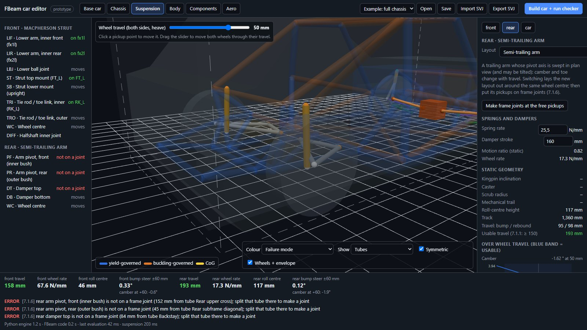

### What the corner tells you

The right panel shows spring rate and stroke (editable), motion ratio and wheel rate, and the static geometry: kingpin, caster, scrub and trail, about the axis the upright actually turns about. Then the curves over travel: camber, toe (bump steer), roll centre, motion ratio, wheel rate, track change (axle shift for solid axles), and halfshaft angle and plunge. The blue band is the usable travel; rule 7.1.1 asks for at least 150 mm.

**car** (next to front and rear) shows the whole car: steering ratio, lock, Ackermann and turning circle, then roll gradient, load transfer split, balance tendency and ride frequencies. The anti-roll bar rates are editable here.

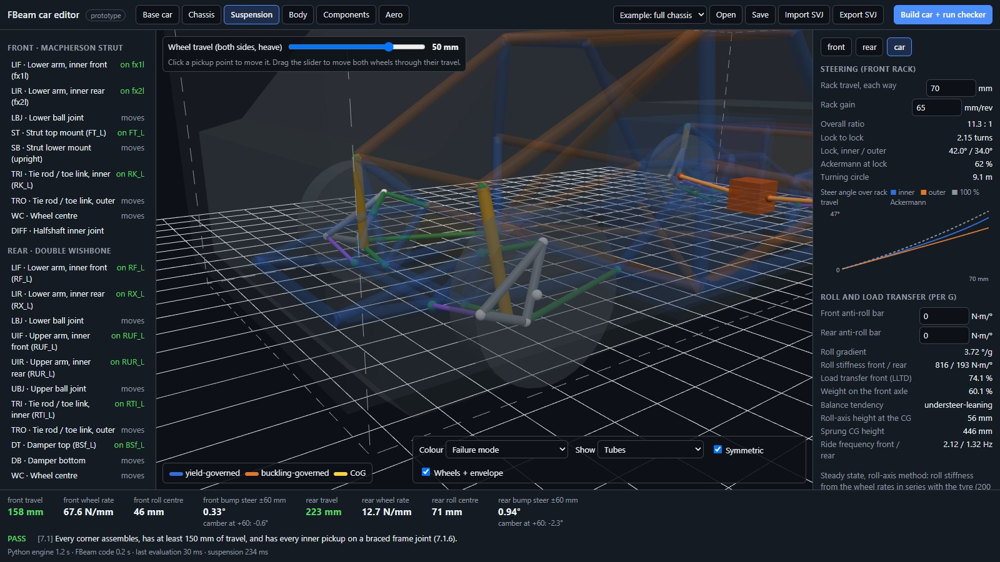

## 7. Body

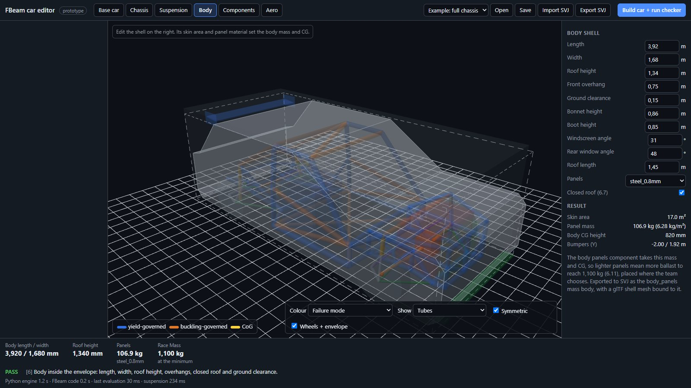

A parametric shell: length, width, roof height, overhang, ground clearance, bonnet and boot height, screen angles, roof length, panel material and closed roof. Its skin area and material give the body mass and CG, which the components take automatically. The issues panel checks the Section 6 limits: body length, width, height, overhangs, closed roof and ground clearance.

## 8. Components and driveline

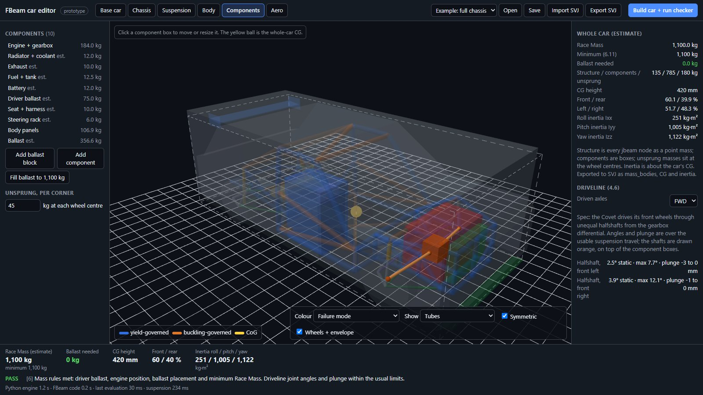

The heavy parts are boxes with mass, position and size: engine and gearbox, radiator, exhaust, fuel, battery, driver, seat, steering rack, body panels and ballast. Click one to edit it. The right panel shows the whole car: Race Mass against the 1,100 kg minimum (6.11), CG height, front / rear and left / right split, and inertia.

- **Fill ballast to 1,100 kg** adds steel on the cockpit floor (6.10). Its height follows from its mass and footprint, so ballast cannot hide in a small low block.
- **Unsprung, per corner** is the mass at each wheel centre.
- **Driveline (4.6):** FWD is the spec (the Covet's gearbox differential, with unequal halfshafts). RWD and AWD can be drawn and analysed for testing. The shafts are drawn orange, and every halfshaft and the propshaft get their joint angle and plunge over the suspension travel.

## 9. Aero

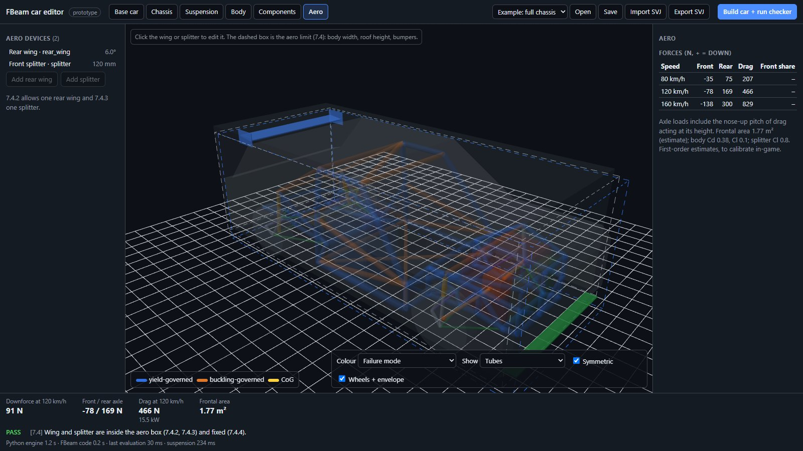

One rear wing and one front splitter (7.4.2, 7.4.3). Click one to edit it: span, chord, angle and endplates for the wing; width and depth for the splitter; and their positions. The table gives the downforce at each axle and the drag at 80, 120 and 160 km/h, including the nose-up pitch of drag. The dashed box is the aero limit: body width, roof height and the bumpers. These are first-order estimates, to calibrate in game.

## 10. Building the car and the checker

**Build car + run checker** writes the whole car as a BeamNG mod, runs the official offline checker on it, and shows the result:

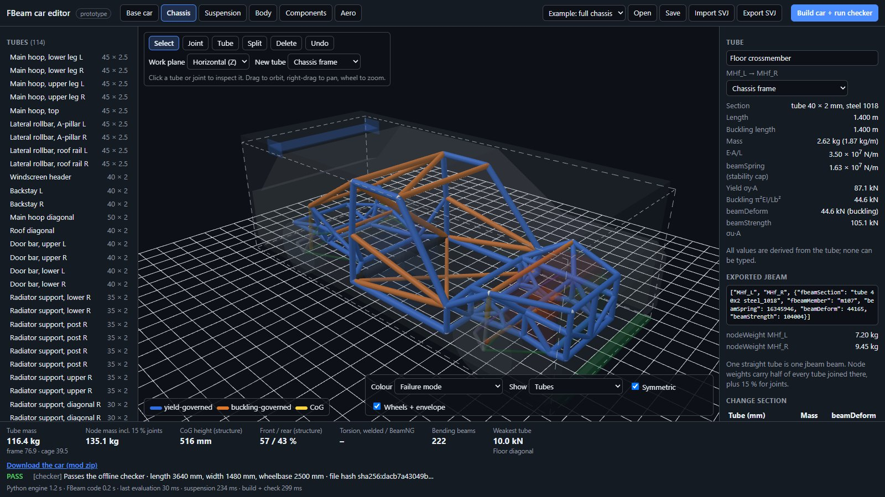

- **PASS** or **ERROR** with the measured length, width and wheelbase, the file hash, and every finding with its rule number.
- **Download the car (mod zip)** gives you `fbeam_car.zip`. It holds:
  - the chassis part, with member beams and bending beams;
  - the suspension part, with the spec wheels fitted;
  - refNodes, `info.json`, `race.pc`;
  - the `fbeam.json` manifest and your design model.

The same zip is what you submit for inspection. Running it in BeamNG has not been verified yet. The spec engine and gearbox attach through the donor interface (the frame carries the Covet's engine attachment nodes).

## 11. SVJ: import and export

SVJ (Standard Vehicle JSON) is a simulator-neutral vehicle file; see [svj.md](svj.md).

- **Export SVJ** writes a zip with the `.svj.json` and the meshes: the tube frame, the body, and any imported meshes. The FBeam design travels inside it, so re-importing restores the full car.
- **Import SVJ** opens a dialog:

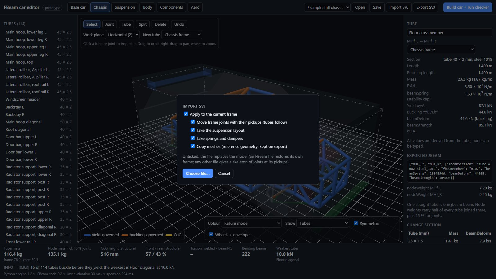

| Option (on by default) | Effect |
| --- | --- |
| Apply to the current frame | Keep your tubes and apply the file's suspension. Untick it to replace the model with the file instead. |
| Move frame joints with their pickups | A pickup the file moved takes its joint along, with the mirror, and the tubes follow |
| Take the suspension layout | Corners switch to the file's layout. New pickups attach to an existing joint within 5 mm or get a new one. |
| Take springs and dampers | Rates from the file (its wheel rate is kept) |
| Copy meshes | The file's glTF meshes, shown as reference and written back on export |

## 12. Saving and opening

- **Save** downloads the design as `car.fbeam.json`. Imported SVJ meshes are not inside it; export an SVJ zip to keep them.
- **Open** loads a `.fbeam.json`.

## 13. Keys and mouse

| Input | Action |
| --- | --- |
| Drag / right-drag / wheel | Orbit / pan / zoom |
| Click | Select a tube, joint, pickup, component or aero device |
| S, J, T, P, D | Select, Joint, Tube, Split, Delete tools (Chassis) |
| Esc | End a tube chain (Chassis) |
| Del or Backspace | Delete the selected joint or tube (Chassis) |
| Ctrl+Z | Undo (all workspaces) |

## 14. Troubleshooting and limits

| Problem | Cause and fix |
| --- | --- |
| The page stays on "Loading Python engine…" | Serve the repository root, not the `editor` folder, and check that the browser can reach cdn.jsdelivr.net (Pyodide, three.js and zip.js load from it) |
| "cannot load …" at start | The page was opened from the file system; use `python -m http.server` from the repository root |
| A pickup is red or orange (7.1.6) | Put it on a joint (Attach, or Make frame joints) and add tubes to that joint, at least three, not all in one plane |
| "Pin-jointed, this frame is N beams short of rigid" | Expected for a real frame: the bending beams cover it. Compute rigidity to see the result. |
| A base car lists missing parts | Pick the whole `content/vehicles` folder, `common.zip` included. A few vanilla configs name parts that no longer exist. |
| The base car looks like a wire cage | Only the node-and-beam structure is drawn so far, not the body meshes |

Known limits of this prototype:
- **In-game:** nothing has been driven in BeamNG yet; the exported car is unverified.
- **Base car:** paints and body meshes are not drawn or edited yet, and its hardpoints are not yet taken into the FBeam workspaces.
- **Suspension models:** the Watt's linkage is analysed as an ideal straight line, and the twist beam in heave only.
- **Rules not in the offline checker:** prism budgets (8.10.4) and the whole-structure comparison (8.10.6), which the editor computes.
