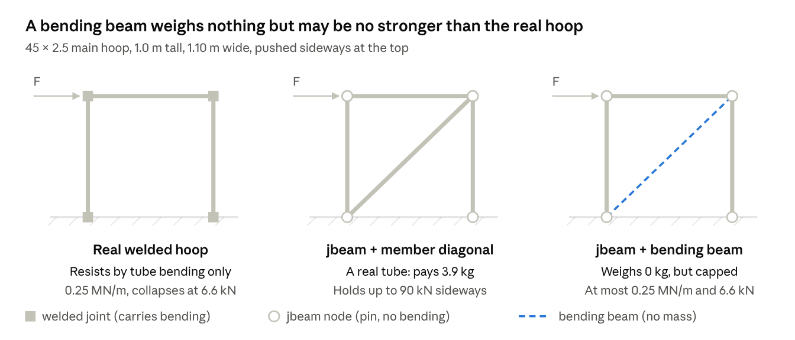
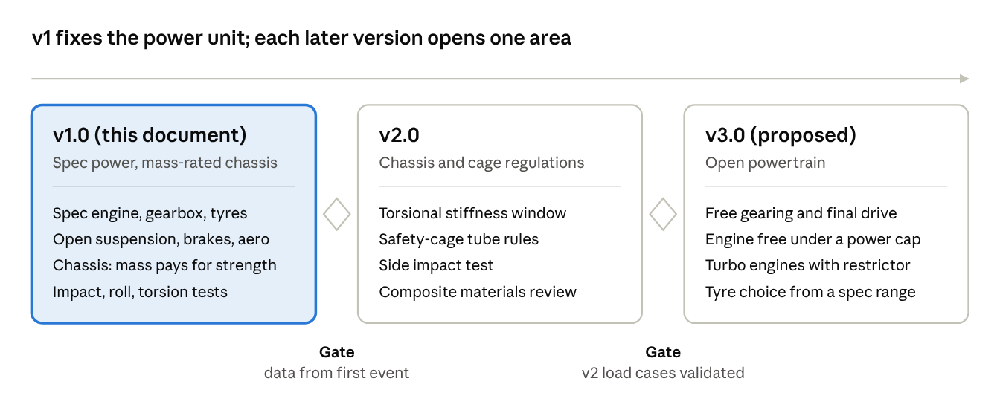

# FBeam Technical Regulations v1.0

Draft v1.0, 30 September 2026. Numbers marked as FBeam choices are starting values to be calibrated in-game.

## 1. Purpose and scope

FBeam v1.0 is a rallycross series for compact cars the size of BeamNG's Ibishu Covet, the donor of the spec power unit: max 3,920 mm long and 1,720 mm wide, wheelbase 2,500 mm. Every car uses the same engine, gearbox and tyres, taken from one vanilla BeamNG.drive vehicle, and teams compete on chassis, suspension, brakes and driving over mixed gravel and tarmac.

- **1.1 Reference series.** The racing format and car concept follow FIA rallycross (Appendix J, Article 279: closed-roof cars, class weight by engine size, treaded tyres, no driver aids). The spec-engine idea comes from Baja SAE, where all teams run one sealed engine. The inspection method (measure, tilt, brake test) comes from Formula SAE.
- **1.2 Phasing.** v1.0 fixes the power unit (engine + gearbox) and tyres. v2.0 will regulate the chassis and body structure; later versions may open the powertrain within limits (section 8).
- **1.3 Platform.** Cars are built and run in BeamNG.drive. Rules refer to BeamNG part slots, jbeam files and tuning variables, so every rule can be checked from the vehicle files or the part config (.pc).
- **1.4 Track.** Rallycross circuits of 800–1,400 m with about 40 % gravel, jumps up to 1.5 m and a joker lap. The car must survive repeated jumps and contact, which drives the suspension-travel and durability rules.
- **1.5 Two competitions.** FBeam has an engineering side and a driving side.
    - **Engineering.** Teams compete on designing the car within these regulations: chassis and cage, mass and weight distribution, suspension geometry, springs and dampers, brake balance and setup.
    - **Driving.** Drivers compete on racing it in rallycross heats and finals.
    - **Why the rules matter to both.** Spec power and tyres keep the gaps down to engineering and driving. The chassis rules close BeamNG's physics shortcuts, so a fast car is fast for real engineering reasons.
    - **Teams and standings.** A team may be one person who designs and drives, or separate engineers and drivers. Separate drivers' and teams' standings are proposed; the scoring will be defined in the sporting regulations, which are not part of this technical document.

## 2. Definitions and general principles

Anything not explicitly permitted by these regulations is prohibited. Where a rule is unclear, the Technical Delegate's written interpretation applies to all teams.

**2.1 Definitions**

| Term | Meaning |
| --- | --- |
| Spec Kit | The official FBeam mod (zip) published by the organisers, containing the spec engine, drivetrain ratios, wheels and tyres as jbeam parts. |
| Spec Part | Any part supplied in the Spec Kit. It must be used unmodified, file hash matching the published version. |
| Team Part | Any jbeam part written by the team, within the freedoms of these rules. |
| Car Submission | One mod zip containing all Team Parts plus one part config file (.pc) that defines the race configuration. |
| Tuning variable | A `$variable` exposed in the BeamNG Tuning menu. Only variables listed as open in these rules may be changed at an event. |
| Race Mass | Total vehicle mass as reported by BeamNG, with fuel as specified in 4.7 and a 75 kg driver ballast node set. |
| Static ride height | Car at rest on level ground, Race Mass, tyres at the declared pressure. |

**2.2 General principles**

- **2.2.1 Physical plausibility.** Team Parts must represent something that could be built. Node masses, beam stiffnesses and damping must be of a realistic order. Invisible or massless structures, nodes placed to exploit the physics solver, and parts that behave as scripts rather than structures are prohibited.
- **2.2.2 No physics exploits.** No Lua controller, electronics module or custom script may add forces, torque or grip, or alter the physics step. Only the controllers allowed in section 7 may be fitted.
- **2.2.3 Spec parts are sealed.** Spec Parts may not be copied, renamed, re-declared or overridden via slot variables, `$=` expressions or duplicate part names in Team files.
- **2.2.4 Game version.** Each event states one BeamNG.drive version. Submissions are inspected and raced on that version only.
- **2.2.5 Burden of proof.** The team must be able to show compliance using the Submission files alone.

## 3. Engineering basis: what the reference series fix and why

FIA rallycross balances cars with a minimum weight per engine size and bans slicks and driver aids; Baja SAE balances them by making everyone run one sealed engine. FBeam v1 combines the two: one spec power unit, one spec tyre, and a minimum mass, so lap time comes from chassis and suspension engineering.

| Area | FIA rallycross RX3 (Art. 279, 2021) | Baja SAE | FBeam v1.0 | Engineering reason |
| --- | --- | --- | --- | --- |
| Car concept | Closed, rigid-roof production car (Art. 1.1); FWD Group A/N, ≤ 1,600 cc, ≤ 4 cylinders (Art. 2.1, 5.1.2) | Purpose-built off-road buggy | Closed-roof compact, Civic 2nd-gen size | Rallycross contact and rollovers need a roof and cage; compact size suits tight RX tracks |
| Engine | Tuned within limits | One stock B&S Model 19, sealed | One vanilla BeamNG engine, sealed | Removes the biggest variable; nothing to police except the file hash |
| Gearbox / diff | Free; mechanical LSD allowed, traction control banned (Art. 7.2) | Free (CVTs common) | Spec gearbox; diff from a short list | Freezing ratios keeps v1 about chassis |
| Mass | Min 1,000 kg for 1,400–1,600 cc, with driver (Art. 4) | Free | Min Race Mass, with driver (6.5) | With spec power, mass is the main performance lever left |
| Dimensions | Production wheelbase and overhangs kept (Art. 3.2) | Width ≤ 162 cm | Max 3,920 × 1,720 mm, wheelbase 2,450–2,550 mm | The Covet's envelope, from the donor files |
| Tyres | Slicks banned; treaded, ≥ 5.5 mm groove depth; wheel + tyre ≤ 650 mm dia, rim ≤ 18 in (Art. 9.1–9.2) | Free | One spec treaded tyre from vanilla BeamNG | In BeamNG, tyre fields are the biggest grip lever and the easiest to exploit |
| Driver aids | ABS, ASR, traction control, ESP banned (Art. 3.4) | n/a | Banned | Same reason, and BeamNG controllers are easy to abuse |
| Suspension | Required; shock absorbers and ARBs within limits (Art. 8) | Free, long travel | Free, ≥ 150 mm usable travel | Jumps and gravel need travel; stops stiff 'kart' setups |
| Brakes | Controlled (Art. 9.3); handbrake used for hairpins | Lock all 4 wheels | Lock all 4; hydraulic handbrake allowed | The handbrake turn is a core rallycross technique |
| Aero | Limited by bodywork rules (Art. 10) | None | Small rear wing and splitter in a box | Low speeds and gravel make aero secondary; limit it to keep cars close |

FSAE-only items (restrictor, open-wheel aero box, 60° tilt) no longer fit a tin-top rallycross car and were removed. What BeamNG adds: numerical exploits (stiff massless beams, extreme tyre coefficients, scripts) that no real series needs rules for, covered in 2.2.

## 4. Power unit and drivetrain (Spec in v1)

The spec power unit is the Ibishu Covet rally package as fitted to the vanilla `rally_gravel` configuration: the 1.8 L SOHC inline-four (`covet_engine_1.8_sohc`) with stage 2 internals, individual throttle bodies, race ECU and race exhaust, the race 6-speed manual (`covet_transmission_6M_race`) and the race LSD, driving the front wheels. The Covet is BeamNG's compact FWD Japanese hatchback, so it matches a 1980s Civic in layout and spirit, and it puts FBeam in the FIA 1,600–2,000 cc class (1,100 kg minimum).

**Verified from the donor files** (`rules/donor_covet.json`, made with `tools/donor_report.py`; no game files are kept in the repository):

| Item | Value |
| --- | --- |
| Engine | `covet_engine_1.8_sohc`, base `maxRPM` 6,500 raised by +2,000 by the stage 2 internals; rev limiter 8,600 rpm (race ECU) |
| Output, offline estimate | about 231 N·m at 6,300 rpm and 167 kW (224 bhp) at 7,500 rpm, from the base curve, the internals multiplier and the ITB adder. Exhaust effects are not included; confirm with the in-game curve. The community figure of 187 bhp / 202 N·m is not confirmed. |
| Gearbox | Race 6-speed manual, ratios 3.00 / 2.33 / 1.86 / 1.50 / 1.21 / 1.00, reverse 3.58. The part's defaults differ (3.27 … 0.74). |
| Final drive | 5.25 in `rally_gravel`. The race final drive is an in-game range variable (2.0–6.0); fixed parts exist at 3.89, 4.06, 4.25 and 5.25. |
| Differential | Race LSD: preload 80 N·m, lock 0.25, reverse lock 0.025 in `rally_gravel` |
| Masses (jbeam node weights) | Engine 142 kg, gearbox 24 kg, differential 18 kg; the whole Covet `rally_gravel` is 1,071 kg of nodes |
| Interface | The engine hangs on six body nodes (`f11`, `f11rr`, `f13ll`, `f13rr`, `f15`, `f15l`); the gearbox attaches to the engine's `e1`–`e4` nodes; the mounts part ties engine, gearbox, body and front suspension together (21 nodes). These are the nodes an FBeam chassis must provide or replace (editor plan 4). |

**4.1 Candidates considered** (all vanilla BeamNG; figures from community wiki pages; only the Covet has been checked against its files)

| Donor car and engine | Output | Gearbox | Layout | FIA class min. mass | Power-to-weight | Fit |
| --- | --- | --- | --- | --- | --- | --- |
| **Ibishu Covet NGRC2**, 1.8 SOHC ITB | 187 bhp @ 6,750, 202 N·m, 8,500 rpm limit | Race 6-speed manual, race LSD, FD 5.15 / 5.25 | FWD | 1,100 kg | 5.9 kg/bhp | Recommended: closest to FIA RX3 |
| Ibishu Covet USDM GTz, 2.0 DOHC NA | 154 bhp @ 6,500, 187 N·m | Close-ratio sport 5MT | FWD | 1,100 kg | 7.1 kg/bhp | Softer entry class, road-car feel |
| Ibishu Covet ZXi, 1.5 DOHC sport intake | 126 bhp @ 6,300, 147 N·m | Close-ratio sport 5MT | FWD | 1,000 kg | 7.9 kg/bhp | Slow for rallycross at this mass |
| Ibishu Miramar Safari Rally, 1.9 DOHC | 212 bhp @ 7,600, 202 N·m | Race 5-speed manual, FD 5.15 | RWD | 1,100 kg | 5.2 kg/bhp | Period-correct (1970s–80s), RWD is spectacular on gravel |
| Hirochi Sunburst, 2.0 flat-4 NA | 143 bhp, 192 N·m | 5MT or race 6-speed sequential | FWD or AWD | 1,100 kg | 7.7 kg/bhp | Only candidate with an AWD option |
| Ibishu Pessima (1996), 2.0 sport NA | 163 bhp | Race 6-speed sequential (from Rally config) | FWD | 1,100 kg | 6.7 kg/bhp | Sequential gearbox; mid-size donor |
| Autobello Piccolina 150 Corse, 1.5 flat-4 | 91 bhp, 142 N·m | Race 5-speed transaxle, race LSD | Rear-engine RWD | 1,000 kg | 11 kg/bhp | Too weak; rear engine does not suit a front-engine Civic body |

Excluded: turbo engines (Covet GTz turbo, Vivace, Sunburst turbo), because FIA scales turbo displacement up (Art. 252.3), which pushes them into heavier classes and makes BeamNG boost tuning a new thing to police. Also excluded: V6/V8 donors (Bolide, Wendover, ETK) and trucks (Pigeon, Stambecco, Dunekicker).

**4.2 Spec engine.** The chosen engine part is used as it ships in the stated BeamNG version: torque curve, `maxRPM` / `revLimiterRPM`, `idleRPM`, `inertia`, friction, thermals and damage values are sealed. Its intake, exhaust and radiator come from the same donor package.

**4.3 Forced induction, nitrous, hybrid.** Prohibited. No turbocharger, supercharger or nitrous slot may be filled.

**4.4 Installation.** Front-engine only, mounted transversely or longitudinally as in the donor, with the engine block's centre no more than 200 mm behind the front axle line. Engine mounts are Team Parts and follow the section 8 mass-strength rule.

**4.5 Gearbox and final drive.** The donor's spec gearbox with the `rally_gravel` ratios above, sealed even though the game exposes them as tuning variables. The rev limiter is sealed at 8,600 rpm. The final drive `$finaldrive_F` is open between 3.89 and 5.25, the span of the donor's fixed final drives.

**4.6 Differential and layout.** Driven axle as the donor (FWD for Covet). The donor's race LSD is allowed; preload and lock coefficients are open tuning variables within the Spec Kit ranges. Active or electronically controlled differentials are prohibited (FIA Art. 7.2). The Covet drives the front wheels through unequal halfshafts from its gearbox differential (inner joints at the Covet's `tra2` and `tra3` nodes); the editor draws them and checks their joint angles and plunge over the suspension travel. RWD and AWD can be drawn and analysed in the editor for testing, but are not legal in v1.

**4.7 Fuel.** Donor fuel tank. Cars are weighed and start each session with 10 L.

**4.8 Engine controls.** No launch control, traction control or anti-lag. The throttle must map pedal to throttle one to one.

## 5. Wheels and tyres (Spec in v1)

The spec tyre is the one the donor package runs: the vanilla 165/70R14 rally tyre (`tire_F/R_165_70_14_rally`, slots `tire_F/R_14x5.5`) on the 14 × 5.5 in `wheel_17a` rim, on all four corners, as in the Covet `rally_gravel` configuration. It is treaded as FIA requires (slicks banned, Art. 9.2), it is simulated at 594 mm outside diameter (jbeam `radius` 0.297 m; nominal 587 mm), within the FIA 650 mm limit, and 14 in rims are what a 1980s Civic ran. The earlier recommendation, the 195/65R15, was based on an unverified forum list; the Covet carries about 1,070 kg on the 165/70R14, so the size is not too small for the class.

Verified in BeamNG's common files (`rules/donor_covet.json`, `rules/fbeam_v1.json` `spec_wheel`): tyre `tireWidth` 0.150 m, `frictionCoef` 1.0, `slidingFrictionCoef` 1.05, `treadCoef` 0.75, `noLoadCoef` 1.22, `fullLoadCoef` 0.5, stock pressure 27 psi; Dreid RallyPro rim, `hubRadius` 0.195 m, `hubWidth` 0.16 m, offset −0.04 m, 16 rays. One wheel weighs 25.2 kg in the simulation (axle nodes 9.0, rim ring 11.5, tread 4.6). Front and rear parts are the same apart from node and variable names.

**5.1 Candidates** (slots and simulated diameters checked in the common files; the 'Used on' column is from a 2019 staff post)

| Tyre | BeamNG slot | Outside dia. | Used on | FIA fit (≤ 650 mm, ≤ 250 mm wide, treaded) | Fit |
| --- | --- | --- | --- | --- | --- |
| 195/65R15 rally | `tire_F/R_15x6` | 642 mm | Shared 15 × 6 rally rims | Yes | Earlier recommendation; tread 0.175 m |
| 175/70R15 rally | `tire_F/R_15x6` | 628 mm | Pessima Rally (Seq) | Yes | Narrower; suits a lighter class |
| 205/65R15 gravel rally | `tire_F/R_15x7` | 652 mm | Vivace NGRC1 Gravel | No, 2 mm over as simulated | Excluded |
| **165/70R14 rally** | `tire_F/R_14x5.5` | 594 mm (587 nominal) | Covet `rally_gravel` (verified), Piccolina 150 Corse Rally | Yes | **Spec**: the donor package's own tyre |
| 175/70R13 mud-terrain | (Miramar Safari) | 575 mm | Miramar Safari Rally | Yes | Loose-surface only; poor on tarmac sections |
| 205/75R15 all-terrain | (Sunburst Off-Road) | 689 mm | Sunburst, Wendover | No, over 650 mm | Excluded |
| 235/40R18 tarmac rally | `tire_F/R_18x8` | 645 mm | Vivace NGRC1 Asphalt | No, semi-slick | Excluded |

**5.2 Sealed fields.** The chosen tyre's `pressureWheels` values are sealed: `radius`, `tireWidth`, `hubRadius`, `hubWidth`, `treadCoef`, all friction and load-sensitivity fields (`frictionCoef`, `slidingFrictionCoef`, `noLoadCoef`, `fullLoadCoef`, `loadSensitivitySlope`), carcass beams (`wheelSideBeam*`, `wheelTreadBeam*`, `wheelPeripheryBeam*`), and node masses.

**5.3 Tyre pressure.** Open tuning variables `$tirepressure_F` and `$tirepressure_R`, 21–33 psi (stock 27 ± 6; the game allows 0–50).

**5.4 Rims and offset.** Spec rim only. The 14 × 5.5 rim has no `_alt` offsets. The wheel is placed by the team's hub part, through the `nodeOffset` of its `wheel_F_4` / `wheel_R_4` slot (as the Covet hub does), so track width is a team choice within the 1,800 mm arch width (6.4).

**5.5 Mixing.** Same tyre on all four corners. No tyre warmers or scripted temperature changes.

## 6. Dimensions, mass and stability

Car size follows the FIA rallycross method, a production-car envelope plus wheel-arch extensions, with the Ibishu Covet as the production car (decided 1 October 2026: FIA rallycross is an approximation, the Covet is the base). The envelope is measured from the Covet's jbeam nodes (`rules/donor_covet.json`): wheels at ±1,250 mm, so a 2,500 mm wheelbase; 3,920 mm bumper to bumper; 1,680 mm over the body and 1,720 mm over the doors; roof at 1,340 mm. FIA Art. 279 has no absolute size limit; it keeps the production car's wheelbase and overhangs (Art. 3.2) and lets the arches stand out at axle height. FBeam allows 40 mm per side over the doors, for tracks wider than the Covet's 1,360 mm.

The earlier Civic envelope (3,870 × 1,580 mm, wheelbase 2,250–2,320 mm) is withdrawn: the Covet does not fit it, and its engine and suspension points are the reference the editor builds on.

| Rule | Limit | Measured | Basis |
| --- | --- | --- | --- |
| 6.1 Wheelbase | 2,450–2,550 mm | Axle centres, static, wheels straight | Covet 2,500 mm ± 50 |
| 6.2 Body length | ≤ 3,920 mm, bumpers included | Plan view | Covet bumper to bumper |
| 6.3 Body width | ≤ 1,720 mm without arches | At the doors | Covet doors (mirrors excluded) |
| 6.4 Width over arches | ≤ 1,800 mm (1,720 + 2 × 40) | At front and rear axle height | FIA-style arch extension, 40 mm per side for a car this wide |
| 6.5 Height | ≥ 1,300 mm roof height | Static | Covet roof 1,340 mm; stops 'slammed' low-CoG bodies |
| 6.6 Overhangs | Front ≤ 760 mm, rear ≤ 680 mm | Axle to bumper, plan view | Covet 750 / 670 mm + 10; FIA keeps production overhangs |
| 6.7 Closed body | Rigid, non-convertible roof | Visual | FIA Art. 1.1 |
| 6.8 Wheel and tyre | Complete wheel ≤ 650 mm diameter and fits a 250 mm gauge | Spec tyre complies | FIA Art. 9.1.1 |
| 6.9 Ground clearance | ≥ 100 mm at static ride height | Lowest point except tyres, wheels and suspension arms | FBeam choice for jumps and gravel |
| 6.10 Ballast | Solid blocks on the cockpit floor, Spec Kit ballast nodes | Declared in the .pc | FIA Art. 4 |

**6.11 Minimum Race Mass.** Weighed with the 75 kg driver ballast on board and fluids as they are, as in FIA Art. 4. The value is set by the spec engine's displacement from the FIA rallycross scale:

| Spec engine displacement | FIA minimum weight |
| --- | --- |
| ≤ 1,000 cc | 770 kg |
| 1,000–1,400 cc | 860 kg |
| 1,400–1,600 cc | 1,000 kg |
| 1,600–2,000 cc | 1,100 kg |

For comparison, the vanilla Covet `rally_gravel` has 1,071 kg of jbeam nodes without a driver; with a 75 kg driver it is close to the FIA figure. The chassis mass rule (section 8) sets how much of that mass the structure must carry; the rest is engine, running gear, driver and ballast.

**6.12 Decision: 1,100 kg for tube-frame cars (30 September 2026).** The 1,100 kg minimum applies unchanged to FBeam's tube-frame cars. With the editor's example estimates, the car weighs about 743 kg before ballast: 135 kg structure, 107 kg steel body panels, 180 kg unsprung (four 25 kg spec wheels plus hubs, uprights and brakes), the 184 kg Covet power unit (donor node weights), and the driver, fuel and fittings. It therefore carries about 357 kg of ballast. Ballast is solid steel (7,850 kg/m³) on the cockpit floor, between the axles. Its block height follows from its mass and footprint, so ballast cannot be hidden in a small, low block (6.10). Lighter panels or a lighter structure mean more ballast, which teams may place to tune weight distribution.

**6.13 Driver ballast.** Every car carries the 75 kg driver ballast of the Race Mass definition (2.1) in the driver's seat. Its centre of gravity is at least 250 mm above the ground, where a seated driver's is, so the driver mass cannot be used as low ballast.

## 7. Open development areas in v1

Chassis (section 8), suspension, brakes and body aero are where v1 teams compete. Each is free except for the limits below, adapted from FIA rallycross to what can be checked in jbeam.

**7.1 Suspension**

- 7.1.1 Front and rear suspension with springs and dampers are required, with at least 150 mm usable wheel travel (jounce + rebound) at Race Mass. FBeam choice: rallycross jumps and gravel need long travel.
- 7.1.2 Geometry is free, and it is where teams make the difference: the layout (MacPherson strut, double wishbone, five-link (multi-link), trailing arm, semi-trailing arm, trailing arm with lateral links, twist beam, and solid axles (4-link with a Panhard rod, 4-link with a Watt's linkage, triangulated 4-link) and de Dion axles (with a Watt's linkage or a Panhard rod) are analysed by the editor; leaf-spring axles are allowed but not yet analysed), pickup points, camber, toe, caster, roll centres, anti-dive and anti-squat. The front wheels must steer, so the front layout needs a tie rod (MacPherson, double wishbone or multi-link).
- 7.1.3 Suspension arms and uprights are Team Parts and follow the mass-strength rule in section 8.
- 7.1.4 Springs, dampers (bump and rebound, fast and slow), bump stops and anti-roll bars are free, and may be exposed as tuning variables.
- 7.1.5 Suspension must be passive. Active or scripted ride height, stiffness or damping is prohibited.
- 7.1.6 Pickups on joints. Every suspension, steering and damper pickup on the frame is a frame joint, and the tubes meeting there must brace it in three dimensions: at least three tubes, not all in one plane (for three unit tube directions a, b, c, |a · (b × c)| ≥ 0.10). A pickup part-way along a tube is not allowed, because jbeam joints are pins and the tube cannot carry the load in bending. Brackets of weightless beams to nearby joints (`fbeamRole: "mount"`) are not allowed either: they are a load path the real frame does not have (8.10.0). The nodes that move with the wheels (uprights, hubs, axle bodies, damper bottoms on arms, Watt's rockers) are listed in `fbeam.json` as `suspension_nodes`; every other node of the chassis parts is frame, whichever part it is written in. A spring, damper or upright beam must join the frame to a suspension node: between two frame joints it would be an invisible brace, and it is refused. The editor and the checker both enforce this.

**7.2 Steering**

- 7.2.1 Front-wheel steering by a mechanical linkage, with positive steering stops. Rack ratio, lock and Ackermann are free.
- 7.2.2 Rear-wheel steering is prohibited.

**7.3 Brakes**

- 7.3.1 Brakes must act on all four wheels from one pedal and be able to lock all four wheels on gravel and tarmac.
- 7.3.2 Brake torque per wheel (`brakeTorque`) is free up to 2,500 N·m front and 1,500 N·m rear; the front/rear bias is a free tuning variable. FBeam choice, to review with the chosen car's stock values.
- 7.3.3 A hydraulic handbrake acting on the rear wheels only is allowed, as used for rallycross hairpins.
- 7.3.4 The BeamNG brake thermal model must stay enabled with Spec Kit pad and rotor thermal values.
- 7.3.5 ABS is prohibited (FIA Art. 3.4).

**7.4 Aerodynamics and bodywork**

- 7.4.1 Body panels are free in shape but must stay inside the section 6 envelope and follow the sheet rule in 8.5.
- 7.4.2 One rear wing is allowed: no wider than the body width (6.3), no higher than the roof, and no further back than the rear bumper.
- 7.4.3 One front splitter is allowed, no more than 50 mm ahead of the front bumper.
- 7.4.4 No moving aero, fans or powered ground effect.
- 7.4.5 Aero forces must come from BeamNG triangle aerodynamics (`dragCoef`, `liftCoef`, `stallAngle`) on real surfaces, within reference maximums the Technical Delegate publishes.

**7.5 Electronics and controllers**

- Allowed: gauges, lights, shift lights, data logging and telemetry apps that only read data.
- Prohibited: traction control, launch control, ESC, ABS, active differentials, and any controller that writes forces, torques or physics parameters (FIA Art. 3.4, 7.2).

## 8. Chassis: mass must match structural strength

In v1 the chassis is free in layout, but every structural beam must carry the mass that a real steel or aluminium member with the same stiffness and strength would weigh. Strength is bought with mass, exactly as in a real car.

**8.1 The problem.** A jbeam beam is an axial spring-damper. Its stiffness (`beamSpring`, N/m), yield force (`beamDeform`, N) and break force (`beamStrength`, N) are set independently of the node masses (`nodeWeight`, kg). In BeamNG a team can therefore build a chassis that is both very strong and very light. In a real structure these are tied together by the member's cross-section.

**8.2 The physical link.** For a real member of material with modulus E, yield stress σy, ultimate stress σu and density ρ, with cross-section area A, second moment I and length L:

```math
k = \frac{E A}{L} \qquad F_{y} = \min\left(\sigma_y A,\; \frac{\pi^2 E I}{L^2}\right) \qquad F_{u} = \sigma_u A \qquad m = \rho A L
```

Eliminating A shows the rule: mass grows with stiffness times length squared, and with strength times length.

```math
m_{min} = \rho L \cdot \max\left(\frac{k L}{E},\; \frac{F_{deform}}{\sigma_y},\; \frac{F_{strength}}{\sigma_u}\right)
```

**8.3 Declared sections.** Every chassis beam group (`beams` section rows between two `beamSpring`/`beamDeform` property changes) must declare a material and a section from the catalogue in 8.4, with an fbeamSection key on its beam property row (for example "tube 45x2.5 steel\_1018"), like the Baja SAE roll-cage rule (25 × 3 mm steel tube or equal EI and Sy·I/c). The FBeam checker then computes, per beam, from its rest length L:

| jbeam field | Must be ≤ | Meaning |
| --- | --- | --- |
| `beamSpring` | E·A / L | No stiffer than the declared tube |
| `beamDeform` | min(σy·A, π²EI / L²) | Yields no later than the tube; long thin members buckle first |
| `beamStrength` | σu·A | Breaks no later than the tube; must be finite |
| `beamDamp` | 2·ζ·√(k·m), m = reduced mass of the two end nodes, ζ ≤ 0.5 (warning only in v1, to calibrate in-game) | Structural damping stays realistic |

The beam's mass ρ·A·L is split half to each end node. Each chassis node must weigh at least the sum of its shares, plus a 15 % allowance for joints, gussets and welds. Mass above that is counted as ballast (6.10), so teams cannot hide ballast low in the floor and call it chassis.

**8.4 Material and section catalogue**

| Material | E (GPa) | σy (MPa) | σu (MPa) | ρ (kg/m³) | Use |
| --- | --- | --- | --- | --- | --- |
| Mild steel (1018 class) | 205 | 365 | 440 | 7,850 | Cage, frame, body shell |
| Chromoly steel (4130 N) | 205 | 460 | 560 | 7,850 | Cage, frame |
| Aluminium 6061-T6 | 69 | 276 | 310 | 2,700 | Subframes, brackets, body panels |

Sections: round tube (outer diameter D, wall t), square tube (side B, wall t), or sheet of thickness t for shell meshes. Minimum wall 1.5 mm for tube, 0.7 mm for sheet. E and σy for steel match the Baja rule; other values are standard handbook figures for the organiser to confirm.

**8.5 Sheet-metal shells.** A unibody like the Covet is a stamped monocoque, modelled in jbeam as a beam mesh. Each shell beam's area is taken as A = t × s, where t is the declared sheet thickness and s the mean spacing to the neighbouring parallel beams. The same limits and mass rule then apply.

**8.6 Worked example.** A 45 × 2.5 mm mild-steel tube, 0.60 m long: A = 334 mm², I = 75,600 mm⁴.

| Result | Value |
| --- | --- |
| Max `beamSpring` | 1.14 × 10⁸ N/m |
| Max `beamDeform` | 122 kN (yield governs; buckling is 425 kN) |
| Max `beamStrength` | 147 kN |
| Mass to end nodes | 1.57 kg (0.79 kg each) |

Typical BeamNG body beams use far lower springs than E·A/L, so in practice strength (`beamDeform`, `beamStrength`) sets the mass, not stiffness. That is the intended trade: a team that wants a chassis that does not bend in a crash pays for it in kilograms.

**8.7 Global validation.** Because jbeam beams have no bending stiffness, a legal set of beams can still form a poorly braced structure. So the per-beam rule is backed by three measured tests on the finished car (section 9): torsional stiffness between axles, a 40 km/h frontal wall impact with a surviving cockpit volume, and a roll-over drop.

**8.8 Checker.** The organisers publish a script that reads the chassis jbeam, the section declarations and the node positions, and prints a per-beam and per-node pass/fail report. Teams run it before submission. The first version (fbeam\_checker, offline part of section 10) is built and tested against a demo tube-frame car.

**8.9 Safety cage: required tubes and worked design**

The recommended FBeam cage uses 45 × 2.5 mm tube for the main hoop and lateral rollbars, 40 × 2.0 mm for the other members and 50 × 2.0 mm for the main-hoop diagonal. For a Civic-size car that is 38.6 kg of tube, and the cage nodes must carry 44.7 kg including joints. Every number below is reproduced by `examples/cage/cage_calc.py`, and the generated cage passes the checker.

**8.9.1 Minimum tubes.** Cage tubes may not be smaller than FIA Appendix J Art. 253-8.3.3: cold-drawn seamless carbon steel, at least 350 N/mm² tensile strength, circular section only.

| Member | FIA minimum (mm) |
| --- | --- |
| Main rollbar, lateral rollbars, rear transverse member | 45 × 2.5 or 50 × 2.0 |
| Lateral half-rollbars and all other cage parts | 38 × 2.5 or 40 × 2.0 |

FBeam cages are declared as `steel_1018` (σu 440 MPa, above the FIA minimum) or `steel_4130n`.

**8.9.2 How stiffness and mass match.** For one straight tube, stiffness and mass share the same area A, so eliminating A links them through the material alone:

```math
k = \frac{EA}{L}, \quad m = \rho A L \;\;\Rightarrow\;\; k = \frac{E}{\rho} \cdot \frac{m}{L^2}, \qquad \frac{E}{\rho}\Big|_{steel} = 2.61 \times 10^{7}\ \mathrm{m^2/s^2}
```

A 1 m steel member of 2.6 kg can therefore be at most 6.8 × 10⁷ N/m stiff. Aluminium has almost the same E/ρ (2.56 × 10⁷), so it saves no mass for stiffness; it only wins on strength per kg (σy/ρ = 102 kJ/kg against 46.5 kJ/kg for mild steel). The same elimination for strength gives Fy = (σy/ρ) · m/L: every kilogram per metre of mild steel carries 46.5 kN before yielding, whatever its diameter.

**8.9.3 Diameter against wall thickness.** Diameter matters for buckling. A tube shorter than L\* yields first; a longer one buckles first, where r = √(I/A) is the radius of gyration:

```math
L^{*} = \pi\, r \sqrt{\frac{E}{\sigma_y}} \qquad F_{cr} = \frac{\pi^2 E I}{L^2}
```

| Tube (mm) | A (mm²) | I (mm⁴) | Mass (kg/m) | E·A (MN) | Yield σy·A (kN) | Ultimate σu·A (kN) | L\* (m) |
| --- | --- | --- | --- | --- | --- | --- | --- |
| 38 × 2.5 | 278.8 | 44,140 | 2.19 | 57.2 | 101.8 | 122.7 | 0.94 |
| 40 × 2.0 | 238.8 | 43,216 | 1.87 | 48.9 | 87.1 | 105.1 | 1.00 |
| 45 × 2.5 | 333.8 | 75,625 | 2.62 | 68.4 | 121.8 | 146.9 | 1.12 |
| 50 × 2.0 | 301.6 | 87,010 | 2.37 | 61.8 | 110.1 | 132.7 | 1.27 |

Mild steel 1018: E 205 GPa, σy 365 MPa, σu 440 MPa, ρ 7,850 kg/m³. Rule of thumb: short, yield-governed members (hoop legs, roof rails) want the heavier-wall tube for strength. Long, buckling-governed members (door bars, diagonals, backstays) want the larger, thinner tube: 40 × 2.0 buckles at the same load as 38 × 2.5 but is 15 % lighter.

**8.9.4 Worked cage for a compact car.** (Laid out for the earlier Civic envelope; the editor example uses the same 18-tube layout moved into the Covet cabin, 39.5 kg with the recommended tubes.) 12 nodes, 18 tubes: main hoop, two lateral rollbars (A-pillar and roof rail), windscreen header, two backstays, main-hoop diagonal, roof diagonal and two door bars per side. Main hoop 1.10 m wide and 1.0 m tall, 0.65 m behind the A-pillar tops.

| Member | Tube (mm) | L (m) | Mass (kg) | E·A/L (N/m) | Yield (kN) | Buckling (kN) | Max `beamDeform` (kN) | Governs | Max `beamStrength` (kN) |
| --- | --- | --- | --- | --- | --- | --- | --- | --- | --- |
| Main hoop, lower leg (×2) | 45 × 2.5 | 0.50 | 1.31 | 1.37 × 10⁸ | 121.8 | 611 | 121.8 | yield | 146.9 |
| Main hoop, upper leg (×2) | 45 × 2.5 | 0.50 | 1.31 | 1.37 × 10⁸ | 121.8 | 610 | 121.8 | yield | 146.9 |
| Main hoop, top | 45 × 2.5 | 1.10 | 2.88 | 6.22 × 10⁷ | 121.8 | 126.5 | 121.8 | yield | 146.9 |
| Lateral rollbar, A-pillar (×2) | 45 × 2.5 | 1.00 | 2.61 | 6.86 × 10⁷ | 121.8 | 153.9 | 121.8 | yield | 146.9 |
| Lateral rollbar, roof rail (×2) | 45 × 2.5 | 0.65 | 1.70 | 1.05 × 10⁸ | 121.8 | 361.8 | 121.8 | yield | 146.9 |
| Windscreen header | 40 × 2.0 | 1.10 | 2.06 | 4.45 × 10⁷ | 87.1 | 72.3 | 72.3 | buckling | 105.1 |
| Backstay (×2) | 40 × 2.0 | 1.21 | 2.26 | 4.06 × 10⁷ | 87.1 | 60.2 | 60.2 | buckling | 105.1 |
| Main hoop diagonal | 50 × 2.0 | 1.52 | 3.61 | 4.06 × 10⁷ | 110.1 | 75.8 | 75.8 | buckling | 132.7 |
| Roof diagonal | 40 × 2.0 | 1.28 | 2.40 | 3.83 × 10⁷ | 87.1 | 53.5 | 53.5 | buckling | 105.1 |
| Door bar, upper (×2) | 40 × 2.0 | 1.25 | 2.34 | 3.92 × 10⁷ | 87.1 | 55.9 | 55.9 | buckling | 105.1 |
| Door bar, lower (×2) | 40 × 2.0 | 1.21 | 2.27 | 4.05 × 10⁷ | 87.1 | 59.8 | 59.8 | buckling | 105.1 |

Node masses follow from 8.3: half of each tube's mass to each end, times 1.15. They range from 1.3 kg at the backstay feet to 6.8 kg at the main-hoop top corners, 44.7 kg in total.

**8.9.5 Three cage options compared**

| Option | Main / other / diagonal (mm) | Tube mass (kg) | Node mass incl. joints (kg) | Weakest member, max `beamDeform` (kN) |
| --- | --- | --- | --- | --- |
| FIA minimum, thick wall | 45 × 2.5 / 38 × 2.5 / 38 × 2.5 | 41.3 | 47.8 | 38.5 (diagonal) |
| FIA minimum, light | 50 × 2.0 / 40 × 2.0 / 40 × 2.0 | 36.2 | 42.0 | 37.6 (diagonal) |
| **Recommended** | 45 × 2.5 / 40 × 2.0 / 50 × 2.0 | 38.6 | 44.7 | 53.5 (roof diagonal) |

The recommended mix has 2.8 kg less tube (3.1 kg less node mass) than the thick-wall FIA cage and 39 % stronger at its weakest member, because the long diagonal is the part that buckles first.

**8.9.6 What BeamNG can actually run.** Real steel stiffness is out of reach at realistic node masses. BeamNG integrates at about 2,000 Hz, and an explicit integrator stays stable only if each beam's frequency is low enough. With μ the reduced mass of the two end nodes and a 0.25 safety factor:

```math
k_{stable} \leq 0.25\,\mu \left(\frac{2}{\Delta t}\right)^2, \qquad \mu = \frac{m_a m_b}{m_a + m_b}, \quad \Delta t = \frac{1}{2000}\ \mathrm{s}
```

For this cage that gives 5–13 MN/m, against 37–137 MN/m for the real tubes, so the jbeam springs are set to the stability limit (about 10–20 % of real). Two consequences: stiffness in BeamNG also costs mass, because a stiffer spring needs heavier nodes to stay stable; and a cage's real rigidity comes from triangulation, which the torsion test (9.4) measures. With 1 kg of reduced mass the formula gives 4 × 10⁶ N/m, close to BeamNG's default `beamSpring` of 4.3 × 10⁶ N/m, which suggests the default is set near this limit. The 2,000 Hz rate should be confirmed in-game. The vanilla Covet supports the cap: over its 3,316 active beams in `rally_gravel`, k/μ has a median of 1.3 × 10⁶ and a 99th percentile of 3.8 × 10⁶ s⁻², just under the cap of 4.0 × 10⁶; only a few suspension and steering beams go higher, up to 6.6 × 10⁶ (`rules/donor_covet.json`).

**8.9.7 Buckling length.** Buckling uses the tube's unbraced length. If a team splits one tube into several jbeam beams with nothing bracing the joints, the buckling length is still the whole tube: the run is followed through every joint where exactly two frame tubes meet and the line turns by 30 degrees or less, and its whole length is used for every segment. A third tube at the joint, or a sharper corner, ends the run. The checker and the editor apply the same rule (`fbeam_checker/buckling.py`); suspension links are not frame tubes and buckle over their own length.

**8.10 Modelling beams: jbeam beams that are not tubes**

Every chassis beam has one of two roles. A **member beam** lies on a real tube's centreline; it pays the tube's mass and meets the axial limits of 8.3. A **bending beam** is added only because jbeam nodes are pins and cannot carry the bending that a welded tube and its joints carry. Bending beams weigh nothing, but their stiffness and strength are capped by the bending capacity of the real tubes they stand in for, so they can never act as an invisible tube.

**8.10.0 Principle.** Weightless beams may be added only to reproduce stiffness and strength that the declared tubes and their welded joints already have through bending and twisting. They may never add a load path, stiffness or strength that the real tube structure does not have. In practice:

- both ends of a bending beam must be nodes of the member tubes it names in `fbeamMember`;
- its budget is computed from the bending capacity of those tubes (8.10.3, 8.10.4), not from the beam itself;
- a new load path between tubes needs a real tube, declared as a member beam and paid for in mass;
- the whole-chassis comparison (8.10.6) decides any case the per-beam rules leave open.



The same hoop three ways. The real welded hoop resists only through tube bending. In jbeam, a real diagonal tube is a member beam and pays its mass. A bending beam is free but capped at the real hoop's own bending strength.

**8.10.1 Why the difference matters.** A 1 m 45 × 2.5 tube is 1,470 times stiffer pulled along its axis (6.8 × 10⁷ N/m) than bent as a cantilever (4.7 × 10⁴ N/m). A real open frame, such as a hoop with no diagonal, relies entirely on that weak bending, so a jbeam brace across it at normal beam values is far stronger than reality. Example: the main hoop of 8.9.4 (45 × 2.5, 1.0 m tall, 1.10 m wide, feet fixed), pushed sideways at the top:

| Model | Sideways stiffness (N/m) | Sideways collapse load (kN) |
| --- | --- | --- |
| Real welded hoop, no diagonal (tube bending) | 2.5 × 10⁵ | 6.6 (four plastic hinges) |
| Real hoop with a 45 × 2.5 diagonal tube | 2.5 × 10⁷ | 90 (diagonal yields) |
| jbeam hoop, pins only | 0 (folds) | 0 |
| jbeam hoop + free diagonal at BeamNG defaults (4.3 MN/m, 220 kN) | 2.4 × 10⁶ | 163 |
| jbeam hoop on its floor tube + corner bending beams at budget (8.10.3) | 8.9 × 10⁴ | 6.6 |

The free diagonal is 9 times stiffer and 25 times stronger than the real open hoop and weighs nothing. If the team wants that strength, it must fit a real diagonal tube as a member beam and pay 3.9 kg for it.

**8.10.2 Declaring roles.** Each chassis beam property row carries `fbeamRole`: `member` (the default) or `bending`. A tube split into several beams is treated as one member for buckling (8.9.7). A bending beam names in `fbeamMember` the member tubes of the corner or corners it braces, comma-separated: the two tubes at each joint whose far ends it joins (8.10.3). A tube prism (8.10.4) also carries `fbeamBending: prism`; prism budgets are not in the checker yet.

**8.10.3 Budget for a corner brace.** A bending beam stands in for the bending of welded corners. A corner is a joint J where two member tubes J–A and J–C meet at an angle between 20° and 160°, with their far ends A and C not already joined by a member tube. The bending beam joins A and C, at a perpendicular distance h of at least 20 mm from J. Each tube, loaded at J with its far end pinned, resists the corner's rotation with 3EI/L, and the corner is the two tubes in series. A beam at lever h turns that into an axial stiffness and strength:

```math
k_{corner} = \frac{1}{\dfrac{L_{JA}}{3 E I_A} + \dfrac{L_{JC}}{3 E I_C}}, \qquad k_{bend} \leq \frac{k_{corner}}{h^2}, \qquad F_{deform} \leq \frac{\min(M_{p,A},\ M_{p,C})}{h}, \quad M_p = \sigma_y Z, \quad Z = \frac{D^3 - d^3}{6}
```

- When several corners have the same far ends, their budgets add. The two diagonals of a closed rectangle each span two corners.
- `beamStrength` is at most 1.2 × `beamDeform`, so the brace stays finite and the corner can still collapse.
- `beamSpring` is then scaled like the member tubes around it (8.10.5).
- The bending beam's `fbeamMember` names the tubes of its corner(s), comma-separated (8.10.2).
- The checker recomputes every budget from the declared tubes (`fbeam_checker/bending.py`), so a value written in the file is never trusted. Only round tubes are handled so far.

Example: the 8.9.4 main hoop welded to a floor crossmember, all 45 × 2.5, 1.0 m tall and 1.10 m wide. M\_p = 1,650 N·m (Z = 4,521 mm³), and the diagonal's lever is h = 0.74 m. Each corner gives 4.0 × 10⁴ N/m and 2.23 kN. A diagonal spans two corners, so before scaling its budget is `beamSpring` 8.1 × 10⁴ N/m, `beamDeform` 4.46 kN and `beamStrength` 5.35 kN.

With both diagonals, the jbeam frame collapses sideways at 2 × 4.46 kN × cos θ (0.74) = 6.6 kN. That is exactly the four-hinge mechanism load 4 M\_p / H of the real welded frame, with H = 1.0 m the hoop height. Its sideways stiffness, 8.9 × 10⁴ N/m, is 43 % of the welded frame's 2.0 × 10⁵ N/m. The model takes each tube's far end as pinned, so it errs on the soft side, and the whole-structure check (8.10.6) decides the rest. An earlier draft of this rule took the budget from a frame model of each opening (racking stiffness K / cos²θ). The corner model replaces it, because it needs no per-opening model and applies to every brace the editor generates.

**8.10.4 Budget for a tube prism.** Type `prism` gives one tube bending stiffness by modelling it as 3 or 4 parallel chord beams on a ring of radius R around the centreline. The chords must not add area or bending that the tube does not have:

```math
\sum A_{chord} \leq A, \qquad \sum A_{chord}\, y^2 = \frac{R^2}{2} \sum A_{chord} \leq I \;\;\Rightarrow\;\; R \leq \sqrt{2}\, r
```

For 45 × 2.5, √2·r = 21.3 mm, close to the tube's own 22.5 mm radius. A wider ring is allowed only with less chord area, A\_chord = 2I/R². Mass is still charged once, on the tube's real area. In practice prisms need very close nodes, which is hard to keep stable in BeamNG (8.9.6), so corner braces (8.10.3) are the usual method. A prism is optional, never required: the default is one tube = one chain of member beams along its centreline. If a prism has lacing diagonals between its chords, they give the tube twist stiffness, capped at the real tube's G·J/L (G = 79 GPa, J = 2I). For a 1 m 45 × 2.5 tube that is only about 210 N·m/deg; a chassis resists twist through triangulated members, not through twisting of single tubes.

**8.10.5 Same scale as the members.** BeamNG runs member springs at about 10–20 % of real stiffness (8.9.6). Bending beams are scaled by the same factor as the members around them, s = k\_set / (E·A/L). Otherwise a bending beam would attract a larger share of the load than in the real car.

**8.10.6 Global check.** Per-beam budgets depend on geometry assumptions, so the final test compares the whole structure. The checker builds two models from the Submission:

- a frame model of the declared member tubes, with bending and welded joints: the real car;
- a pin-jointed model of all jbeam chassis beams, member and bending, using their jbeam values.

Four standard load cases are applied: torsion between the axles, vertical bending, a sideways load at the main-hoop top, and a roof load. In each case, the jbeam model's stiffness, divided by the scale factor s, and its first-failure load must not exceed the frame model's by more than 10 %. This makes extra jbeam beams free as modelling tools, while the car as a whole can be no stiffer or stronger than the tubes it pays for.

**8.10.7 Checker status.** The checker reads `fbeamRole` (bending, spring, upright; `mount` is refused under 7.1.6) and checks every bending beam against a budget it recomputes from the real tubes at that corner, scaled like those tubes (8.10.5). That budget is the 8.10.3 corner model (`fbeam_checker/bending.py`). Split tubes are grouped for buckling (8.9.7). Not in the checker yet: prism budgets (8.10.4), and the whole-structure frame-model comparison (8.10.6). The frame model itself exists (`fbeam_checker/frame.py`) and the editor already runs all four 8.10.6 load cases (torsion, bending, sideways at the hoop top, roof) against it.

**8.11 Roadmap**



Each version opens one area only after the previous one has been raced, so the effect of each freedom on the field can be measured.

## 9. Technical inspection and penalties

Every car passes a seven-step inspection on the event's BeamNG version before it may take part; the steps run in order and a failed step stops inspection until fixed.

1. **9.1 File check.** Spec Part files are hash-compared with the published Spec Kit. The .pc is loaded and every open tuning variable is checked against its allowed range.
2. **9.2 Chassis checker.** The section 8 script checks every structural beam against its declared section, and every node's mass against its share (8.3).
3. **9.3 Static measurement.** On the level inspection pad: wheelbase, length, width, arch width, height, overhangs, ground clearance and Race Mass (section 6), read from node positions and the vehicle mass readout.
4. **9.4 Torsional stiffness.** Rear axle held, front axle twisted by a set torque; the twist angle gives stiffness in N·m/deg. v1 records it; v2 will set a window.
5. **9.5 Impact and roll-over.** A sacrificial copy hits the standard wall at 40 km/h, and is dropped on its roof from 1 m. The cockpit volume around the driver ballast must remain.
6. **9.6 Suspension travel and brake test.** Wheel travel is checked at ≥ 150 mm (7.1.1). From 60 km/h the car must lock all four wheels on one pedal application (7.3.1).
7. **9.7 Seal.** The inspected .pc and zip hash are recorded. Any later change requires re-inspection.

**9.8 Penalties**

| Infringement | Penalty |
| --- | --- |
| Modified Spec Part, or physics exploit (2.2) | Disqualification from the event |
| Under minimum Race Mass at post-race check, or chassis node under its mass share | Disqualification from that session |
| Tuning variable outside range | Session time deleted; fix before next session |
| Dimensional or aero box breach | Not allowed to start until fixed |
| Change after seal without re-inspection | Disqualification from the event |

## 10. Inspection tool and car passport

Inspection is done by an official FBeam tool. Every car that passes gets a signed car passport holding two hashes: one for the files and one for the car as BeamNG actually builds it. The race mod checks the passport each time the car spawns, so a car cannot be changed after inspection without it showing.

**10.1 Tool parts**

| Part | Runs | Does |
| --- | --- | --- |
| Offline checker | Team PC and organiser, outside the game (script) | Reads the Submission zip and .pc: Spec Part hashes, tuning ranges, section 8 beam and node mass check, dimensions from node positions |
| In-game test harness | BeamNG, as an FBeam mod on a test map | Runs the section 9 dynamic tests (weigh, ride height, wheel travel, brakes, torsion, impact, roof drop) and exports a report |
| Registry and signer | Organiser only | Stores each passed car and signs its passport with the organiser's private key |
| Race mod | Every race session | Recomputes the hashes when a car spawns and compares them with the signed passport |

**10.2 The two hashes**

- **File hash.** SHA-256 over a sorted list of every file path in the Submission plus the SHA-256 of that file's bytes. The zip file itself is not hashed, because re-zipping changes timestamps and compression without changing the car.
- **Physics hash.** SHA-256 over the car as the game assembles it: every part, node (position, mass), beam (spring, damp, deform, strength), wheel, powertrain and controller after all slots and `$variables` resolve. This catches changes the file hash misses, such as a different part picked in the .pc or a clash with another installed mod.

**10.3 Open tuning variables.** Teams may change open settings (tyre pressure, dampers, ARBs, brake bias, diff settings) between sessions. So the physics hash is taken with every open variable set to its default, and the actual values are checked against their allowed ranges at spawn. Changing an allowed setting keeps the seal; changing anything else breaks it.

**10.4 Car passport.** A small signed JSON file per car:

```json
{
  "car_id": "FB-012",
  "team": "<team name>",
  "beamng_version": "<event version>",
  "spec_kit_version": "1.0.0",
  "file_hash": "sha256:…",
  "physics_hash": "sha256:…",
  "race_mass_kg": 1104.6,
  "tuning_ranges": { "tyre_pressure_psi": [20, 32] },
  "inspected": "<date>",
  "signature": "ed25519:…"
}
```

The race mod holds only the organiser's public key, so teams can read and check a passport but cannot make one.

**10.5 Limits.** A hash proves the car has not changed since inspection; it does not prove the car is legal. That is still the checker's and the Technical Delegate's job. A new BeamNG version can change the physics hash of an unchanged car, so each game update means re-hashing, not re-designing. In single-player events, the game install itself can be modified; the passport check is only fully trusted when the organiser runs the race or the server.

## Sources

- [FIA Appendix J, Article 279 – Technical Regulations for Rallycross Cars (2021)](https://www.fia.com/sites/default/files/279_2021_wmsc_2021.03.05.pdf): Art. 1.1, 2.1, 3.2, 3.4, 4, 5.1.2, 7.2, 9.1–9.2, 10 (fenders). Check against the current year.
- [Honda Civic (second generation), Wikipedia](<https://en.wikipedia.org/wiki/Honda_Civic_(second_generation)>): length, width, height, wheelbase and curb weight by body style.
- [Baja SAE Rules 2018](https://bajasae.net/content/2018-BAJA-RULES-FINAL-2017-08-30.pdf): required sealed engine, roll-cage material equivalence (EI, Sy·I/c, 1018 steel values).
- [Formula SAE Rules 2025, v1.0](https://sites.usnh.edu/unh-precision-racing/wp-content/uploads/sites/136/2025/03/FSAE_Rules_2025_V1.pdf): inspection method (IN rules), brake requirements (T.3).
- [BeamNG documentation: Pressure Wheels](https://documentation.beamng.com/modding/vehicle/sections/wheels/) and [JBeam file sections](https://documentation.beamng.com/modding/vehicle/sections/): jbeam field names.
