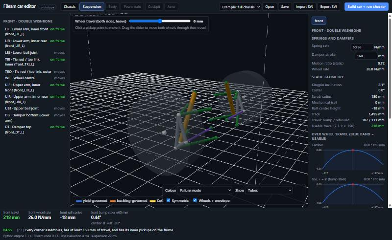

# SVJ compatibility (Standard Vehicle JSON)

FBeam reads and writes [SVJ, Standard Vehicle JSON](https://github.com/RFloEng/SVJ-standard-vehicle-json) (spec v0.99.1, Apache-2.0), a simulator-neutral file for a complete vehicle. Use it to:
- start an FBeam car from an existing vehicle's hardpoints (a **skeleton**);
- hand an FBeam design to vehicle-dynamics tools that read SVJ, for **dynamics studies**.

The converter is `editor/fbeam_svj.py`, used by the editor's **Import SVJ** and **Export SVJ** buttons and tested in `tests/test_editor_core.py`.



*The MX-5 ND2 template from the SVJ repository imported as a skeleton: pickup joints only, front double wishbone analysed. The rear multi-link is kept in the file but not analysed.*

## What was verified

| Check | Result |
| --- | --- |
| FBeam export against the official `schema/svj.schema.json` and `tools/validate.py` | Valid SVJ 0.99.1, 0 errors |
| FBeam → SVJ → FBeam | Lossless: tubes, joints, axles, hubs and suspension identical |
| External edit (tie-rod end moved in the SVJ file) → FBeam | Picked up and reported |
| MX-5 ND2 template → FBeam → SVJ | Valid. Tyres, powertrain, masses and the unsupported rear corner pass through unchanged; front hardpoints drift 0.0 mm; wheel rate 26,000 → 26,001 N/m (rounding) |
| FF MacPherson skeleton example → FBeam | Front MacPherson analysed; rear torsion beam reported as not supported |
| SVJ bundle (svj + generated `.glb`) → FBeam → bundle | Lossless. Frame mesh bound as `SVJ::body::chassis`; imported body meshes kept, with the frame as a helper node; all valid against the schema |

## Frames

| | FBeam / BeamNG | SVJ (SAE J670) |
| --- | --- | --- |
| X | left | forward |
| Y | rear | right |
| Z | up | down |
| Origin | mid-wheelbase, ground | front-axle centre, ground |

Both frames are right-handed:

```math
X_{SVJ} = -(y - y_{front}), \qquad Y_{SVJ} = -x, \qquad Z_{SVJ} = -z
```

## Mapping

| FBeam | SVJ | Notes |
| --- | --- | --- |
| Corner `front` / `rear` (left side, mirrored) | `suspension.FL/FR/RL/RR` | SVJ requires every corner explicitly; FBeam writes both sides. On import, FBeam uses the left side and warns if the right is not its mirror. |
| MacPherson `LIF`, `LIR` | `links[lower_control_arm].inboard_points` | |
| `LBJ`, `TRO`, `WC` | `upright.hardpoints.lower_ball_joint`, `steering_tie_rod_end`, `wheel_center` | Rear toe link: `toe_link` link and `toe_link_outer` hardpoint |
| `ST` | `links[strut].inboard_points` and `hardpoints.strut_top` | As in the SVJ skeleton, `strut_top` equals the turret point at design height |
| `SB` | `hardpoints.strut_lower` (custom) and `damper.outboard_mount` | Fixes the strut axis. If missing on import, the axis is assumed through the lower ball joint (warned). |
| Double wishbone `UIF`, `UIR`, `UBJ` | `links[upper_wishbone]`, `hardpoints.upper_ball_joint` | |
| `DT`, `DB` | `damper.inboard_mount`, `outboard_mount`; `hardpoints.damper_outboard` | FBeam mounts `DB` on the lower wishbone; recorded in the corner's `x_fbeam.damper_outboard_body` |
| Coil rate (N/mm) | `spring.rate` = **wheel rate** (N/m), plus `spring.motion_ratio` | SVJ stores the wheel rate. Import keeps the file's wheel rate and back-calculates the coil rate with FBeam's geometric motion ratio. It warns when that differs from the declared one by more than 5 % (spec §9.3). |
| Damper coefficients (N·s/m) | `damper.bump_curve`, `rebound_curve` (linear) | |
| Static KPI, caster, scrub, trail; travel limits | `alignment`; `bump_stop.gap`, `rebound_stop.gap` | |
| Spec tyre 165/70R14 on 14 × 5.5 in | `wheel` (rim and tyre dimensions) | |
| Wheelbase, track | `chassis.wheelbase`, `track_front`, `track_rear` | |
| Rigidity, welded-frame model | `chassis.chassis_stiffness.torsional_stiffness` (N·m/°), `bending_stiffness` (N/mm), `measurement_method: calculated` | The jbeam (pin-jointed) value goes in `x_fbeam` |
| Components (engine, driver, fuel, ballast …) and structure | `chassis.mass_bodies` (id, category, mass, position, box inertia), `mass_unsprung_per_corner`, `mass_total`, `center_of_gravity`, `inertia` | When the model has components, FBeam owns these fields. Bodies plus unsprung sum to `mass_total` (§7.2.2). Estimates are flagged `_est`. An SVJ without FBeam data imports its `mass_bodies` as components. |
| Structure mass and CoG (no components) | `x_fbeam.structure`; `center_of_gravity` if the file has none | Marked as structure only |
| Front rack (travel, gain) and the steering sweep | `steering`: `type`, `rack_position`, `rack_travel` (total, m), `overall_ratio`, `lock_to_lock` (turns) | Written whenever there is a front corner, so the block is complete and valid |
| Rear wing and splitter (Aero workspace) | `aerodynamics`: `reference.frontal_area`, `coefficients` (Cd, Cl, Cl_front, Cl_rear at 80 km/h, negative Cl = downforce), `components` (name, type, position, area, Cd/Cl contributions, wing setting) | First-order estimates; the per-speed forces are in `aerodynamics.x_fbeam` |
| Body shell (Body workspace) | `mass_bodies.body_panels` with a glTF mesh `meshes/fbeam_body.glb` bound as `SVJ::body::body_panels` | Mass and CG from the shell's skin area and panel material |
| Tube frame, joints, pickup-to-joint links | `x_fbeam.model` | SVJ has no tube-frame concept; this makes the round trip lossless |

## Importing: replace the model, or apply to the current frame

Import SVJ opens a dialog. **Apply to the current frame** is on by default whenever the model has tubes:

| Option (default on) | What it does |
| --- | --- |
| Move frame joints with their pickups | A pickup on a frame joint that moved by more than 1 mm takes its joint along, with the joint's mirror; every tube on the joint follows. Off: the pickup is detached and left free, and 7.1.6 reports it. |
| Take the suspension layout | Each corner takes the file's layout (MacPherson and double wishbone from any tool; every FBeam layout from FBeam files). A pickup with no joint attaches to an existing joint within 5 mm, or gets a new joint with no tubes yet (7.1.6 asks for bracing). Off: a corner whose layout differs is left alone. |
| Take springs and dampers | Spring, damper and stroke from the file; the file's wheel rate is kept through FBeam's own motion ratio. |
| Copy meshes | The file's glTF meshes (not FBeam's own generated frame and body) and its chassis visual binding are kept, shown as reference geometry and written back on export. Tyres, powertrain and masses are not taken. |

The file's front axle is placed on the car's front wheel centres. A file's own FBeam frame (`x_fbeam.model`) is ignored when applying. With the first box unticked, the file replaces the model as before: an FBeam file restores its own frame, and any other file gives a skeleton of joints at its pickups. In code: `fbeam_editor_core.apply_svj`, or `import_svj_bundle` with a base model.

## Meshes (glTF visual binding, SVJ §22)

An SVJ may list glTF meshes in `assets.meshes`, each an `id` plus a **relative** `uri` to a `.glb` or `.gltf` file. Bodies link to them with a `visual` block: `{"mesh_ref": "<asset id>", "node": "SVJ::<category>::<id>"}`. Visual blocks can sit on `chassis`, on a suspension corner (its upright), on `mass_bodies`, and on aero components. Because the paths are relative, FBeam moves SVJ and meshes together as a **zip bundle**.

| | FBeam behaviour |
| --- | --- |
| Import | Pick a `.zip` bundle, or an `.svj.json` together with its mesh files. Every listed mesh is found (by its path, or by file name for loose files), its glTF node names are read, and every `visual` binding is checked: the file is present, and the node exists in it. Missing files and nodes are reported. |
| Display | Meshes are drawn as translucent reference geometry (toggle "SVJ meshes"). They are placed with the glTF axis convention from `_metadata.coordinate_system` when it is an object, or the §22.4 default (Y up, −Z forward, as Blender exports). Checked in the browser: FBeam's own exported frame mesh lands exactly on its jbeam beams. |
| Export | Export SVJ writes `fbeam_car_svj.zip`: the `.svj.json`, a generated `meshes/fbeam_tube_frame.glb` of the tube frame, and every mesh that came with the imported file, at its original path. |
| Binding of the FBeam frame | If the chassis has no visual yet, the frame mesh is bound as `SVJ::body::chassis`. If the imported file already binds a body mesh to the chassis, that binding is kept, and the frame goes in as a second asset with the helper node `SVJ::helper::fbeam_tube_frame`, referenced from `x_fbeam.frame_mesh`. |
| Safety | Zip entries that would land outside the import folder are refused. |

The generated GLB is written in the §22.4 convention: glTF x = SAE Y, glTF y = −SAE Z, glTF z = −SAE X. It has one node, one mesh (a 10-sided tube per member at its real diameter), normals, and a double-sided steel material. Meshes are kept in memory with the imported SVJ; saving a `.fbeam.json` design model does not include them, so re-import the bundle or export the SVJ zip to keep them.

## Ownership on export

FBeam writes the geometry it designs: hardpoints, links, spring and damper mounts and rates, alignment, wheelbase, track and chassis stiffness. Everything else in an imported SVJ passes through unchanged: tyres (Pacejka), powertrain, masses and inertias, brakes, aero, corners FBeam does not model, and other `x_` extensions.

When there is no imported file, `chassis.mass_total` is written as the FIA class minimum (1,100 kg) with `_est: true`. The CG is the structure only, flagged as such. Real values come from the Powertrain and Cockpit workspaces later, or from an imported SVJ.

`steering` is written from the FBeam rack design (travel and gain) and the steering sweep, so it always carries SVJ's required `rack_travel`, `overall_ratio` and `lock_to_lock`.

## Not supported yet

- **Kinematics for other topologies:** `chapman_strut` and the multi-axle types are imported and passed through, but not analysed. `multi_link`, `trailing_arm`, `semi_trailing_arm`, `torsion_beam`, `solid_axle` and `de_dion` are written by FBeam and read back from FBeam files (each link keeps its FBeam point names in `x_fbeam`); the same types from other tools are passed through, because their link naming is not standard.
- **Other data:** bushings (compliance), ARB, and halfshaft positions in `powertrain.half_shafts` (FBeam keeps the inner joint in `x_fbeam`).
- **Mesh editing:** imported glTF meshes are reference geometry only. They are not edited, not animated with the suspension, and not converted to BeamNG flexbodies yet.

## For dynamics studies

An exported SVJ already carries what a vehicle-dynamics tool needs from FBeam:
- exact hardpoints for kinematics;
- wheel rates and motion ratios;
- damper curves and travel limits;
- wheelbase and track;
- chassis torsional and bending stiffness.

What it still lacks are measured masses, inertias and tyre data. Add those to the SVJ, or import an SVJ that has them: FBeam keeps them on every later export.
